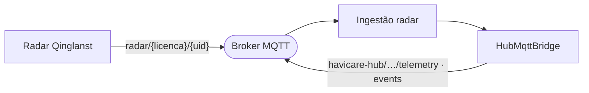
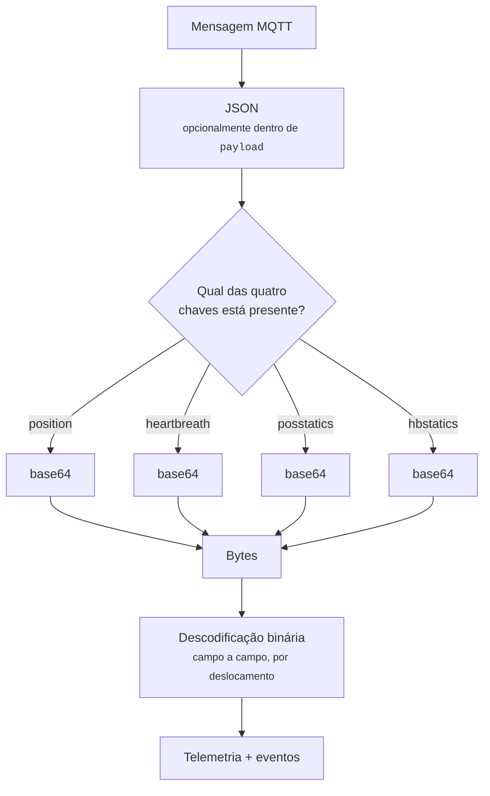

# 04 — Ingestão MQTT: radar

## Âmbito

O radar **Qinglanst** deteta presença humana sem recurso a imagem. Reporta a
posição dentro de uma divisão, a postura — de pé, sentado ou no chão — e, a
curta distância, a frequência respiratória e cardíaca. Sendo um equipamento
fixo, dispensa a utilização e o carregamento exigidos por dispositivos vestíveis.

Três características distinguem esta ingestão das restantes:

1. **Sessão própria no mesmo broker.** O hub estabelece uma segunda ligação
   MQTT, com credenciais e identificador de cliente próprios. O servidor é o
   mesmo da ingestão restante — o que separa as duas são os tópicos.
2. **Corpo binário codificado em base64 dentro de um envelope JSON.** O conteúdo
   não é legível sem descodificação.
3. **Desativada por omissão.** `QINGLANST_ENABLED` é a única variável de
   ingestão cujo valor por omissão é `false`.



## 1. Tópicos subscritos

```text
radar/{licenca}/{uid}
```

Por omissão `radar/1001/#`, configurável em `QINGLANST_TOPIC_FILTER`. O tópico
traz um número de licença, mas **não é ele que decide o dono**: o radar é
resolvido na [whitelist](07-multi-inquilino.md) pelo `uid`, e é de lá que sai a
licença com que os dados são publicados. O número do tópico serve apenas para a
notificação de aparelho desconhecido levar uma pista consigo — o mesmo
tratamento, e pela mesma razão, que o [NCS](03-ingestao-mqtt-ncs.md) recebe:
quem publica no broker é que escreve o tópico.

A ligação usa `QINGLANST_MQTT_HOST`, `_PORT`, `_USERNAME` e `_PASSWORD`, com
identificador de cliente com prefixo `qinglanst-radar`. O `QINGLANST_MQTT_HOST`
aponta para o mesmo servidor que o `MQTT_HOST` — o broker é um só.

## 2. Desembrulhar a mensagem



Tem de estar **exatamente uma** das quatro chaves. É ela que diz como
interpretar os bytes.

### `position` — onde estão as pessoas

Blocos de **16 bytes**, um por pessoa detetada:

| Deslocamento | Campo | Notas |
|---|---|---|
| 0 | índice da pessoa | `88` é um marcador do fabricante, filtrado |
| 1 | posição X | decímetros, com sinal (complemento a 256) |
| 2 | posição Y | decímetros, com sinal |
| 3 | posição Z | centímetros |
| 12 | tempo restante | segundos |
| 13 | postura | de pé, sentado, deitado, no chão… |
| 14 | último acontecimento | entrada, saída, queda… |
| 15 | área | o número da área da planta em que a pessoa entrou ou saiu |

Sai como telemetria `presence`, com `peopleCount` e a lista `people` — oito chaves
por pessoa:

| Chave | |
|---|---|
| `personIndex` | O índice que o radar lhe deu nesta trama |
| `xPositionDm` · `yPositionDm` | Decímetros, com sinal, relativos ao radar |
| `zPositionCm` | Centímetros |
| `timeLeftS` | Segundos |
| `areaId` | O número da área na planta, o mesmo das entradas e saídas |
| `posture` | Ver abaixo; `unknown` quando a trama não a traz |
| `lastEvent` | `unknown` quando a trama não o traz |

A `posture` é a enumeração do hub, e a da queda é a mesma: `initialization`,
`walking`, `standing`, `sitting`, `lying_down`, `suspected_fall`, `fallen`,
`suspected_sitting_on_ground`, `sitting_on_ground`, `suspected_sitting_up_in_bed`,
`sitting_up_in_bed`. O fabricante distingue o sentar numa cama comum do sentar na
cama de monitorização; para o hub é o mesmo `sitting_up_in_bed`.

> **Isto não é o `location` canónico.** São coordenadas relativas ao próprio
> radar, em decímetros, dentro de uma divisão — não latitude e longitude. O
> código diz isso explicitamente, para ninguém as confundir.

### `heartbreath` — sinais vitais

Respiração no byte 1, frequência cardíaca no byte 2, estado de sono nos dois
bits altos do byte 13.

Produz até três telemetrias, **nas mesmas formas que um relógio produz**:

| Capacidade | `data` |
|---|---|
| `heart_rate` | `{ "bpm": 74 }` |
| `breath_rate` | `{ "breathsPerMinute": 16 }` |
| `sleep_state` | `{ "state": "deep_sleep" }` — `awake` · `light_sleep` · `deep_sleep` |

A uniformidade é intencional: a apresentação de uma frequência cardíaca é
independente da origem da medição.

**O valor zero não constitui uma leitura**, mas a indicação de ausência de
deteção. A sua publicação como telemetria apresentaria "0 bpm", interpretável
como paragem cardíaca. Também não é alarme: com a respiração e a frequência a
zero o radar está a olhar para um quarto vazio, e não sai nada.

### `posstatics` e `hbstatics` — estatísticas por minuto

Resumos acumulados: distância percorrida, tempo de pé, na cama, em meditação, e
médias de respiração e frequência cardíaca. Saem como `position_minute_stats` e
`vitals_minute_stats`, que são os nomes que o catálogo de capacidades declara —
o `posstatics` e o `hbstatics` são os nomes das mensagens do fabricante e ficam
no `source.nativeType`, que é onde a identidade de protocolo pertence.

| Capacidade | `data` |
|---|---|
| `position_minute_stats` | `peopleCount`, `walkingDistanceMeters`, `walkingTimeS`, `meditationTimeS`, `inBedTimeS`, `standingTimeS`, `multiplayerTimeS`, `breathingActive`, `version` |
| `vitals_minute_stats` | `realTimeBreathsPerMinute`, `realTimeHeartRateBpm`, `avgBreathsPerMinute`, `avgHeartRateBpm`, `breathingStatus`, `heartRateStatus`, `vitalSignsStatus`, `sleepState` |

Os tempos são **segundos dentro da janela de um minuto**: nunca passam de 60, e
os quatro estados de postura somam no máximo 60 entre si.

A distância é em metros, como o documento do fabricante a declara (secção 3.3.4
do *Cloud2cloud integration*).

## 3. Detecções

Cada detecção sai com o tipo do que aconteceu, o mesmo que um relógio usa para a
mesma coisa, e a gravidade vai na `severity` (ver o [contrato MQTT](08-contrato-mqtt.md)).

| Origem | O que o radar diz | `type` | `data` |
|---|---|---|---|
| `position` | `fallen` | `fall` | `confirmed: true`, `posture: lying_down`, `personIndex` |
| `position` | `suspected_fall` | `fall` | `confirmed: false`, `posture: lying_down`, `personIndex` |
| `position` | `sitting_on_ground` | `fall` | `confirmed: true`, `posture: sitting_on_ground`, `personIndex` |
| `position` | `enter_room` · `leave_room` | `zone_entry` · `zone_exit` | `zone: room`, `personIndex` |
| `position` | `enter_area` · `leave_area` | `zone_entry` · `zone_exit` | `zone: area`, `personIndex`, `areaId`, `areaName`, `areaType` |
| `hbstatics` | `heartRateStatus` `high` · `low` | `heart_rate_high` · `heart_rate_low` | `bpm`, a média do minuto |
| `hbstatics` | `breathingStatus` `hyperpnea` · `hypopnea` | `breath_rate_high` · `breath_rate_low` | `breathsPerMinute`, a média do minuto |
| `hbstatics` | `breathingStatus` `apnea` | `apnea` | — |
| `hbstatics` | `vitalSignsStatus` `weak` | `weak_vital_signs` | — |

Os alarmes de frequência alta ou baixa são o estado de cada minuto do `hbstatics`,
que o radar calcula com os limites configurados nele (as configurações
`heart_rate_alert` e `breath_rate_alert`). O hub não compara amostras com números
seus. Quão grave é decide-o a `severity`: acima de 160 ou abaixo de 20 bpm é
alarme, o resto é alerta.

**Uma detecção por pessoa.** Numa trama com duas pessoas, a entrada de uma não
esconde a queda da outra. Dentro da mesma pessoa, a postura ganha ao movimento.

**O que dura sai uma vez.** O radar repete a postura e os vitais a cada segundo:
uma queda que se mantém um minuto eram sessenta eventos. A ponte guarda o que
estava ativo na trama anterior do mesmo tipo e só publica o que é novo — a queda
que começa, e não a que continua. Os valores medidos não contam para isto: uma
frequência alta que passa de 130 para 134 é a mesma.

**A área vem da planta.** O radar diz o número da área; o nome e o tipo são os
da [planta sincronizada](#6-os-tipos-de-área-da-planta). Sem planta, o evento
leva só o `areaId`.

**Todos os valores publicados são [enumerações em inglês](06-normalizacao.md),
em minúsculas com underscores** —
`lying_down`, `deep_sleep`, `hypopnea`. As etiquetas do documento do fabricante
não saem no fio: traduzir para o idioma de quem lê é trabalho de
quem desenha a interface.

A postura 3, a que o documento chama *Squatting*, sai como `sitting`: é a de quem
está sentado numa cadeira, e não há outro código para ela.

Um estado que o firmware acrescente numa versão nova sai na mesma forma, derivada
da etiqueta, em vez de se perder num `unknown`.

> A publicação de uma `fall` constitui o relato de uma deteção do equipamento. A
> `severity` diz quão grave o hub a considera; a decisão sobre a resposta cabe à
> aplicação que integra.

## 4. Limitação da taxa de escrita

Duas escritas da dashboard são amostradas, e nenhuma delas é telemetria.

| Escrita | Intervalo mínimo | Variável |
|---|---|---|
| "vi este aparelho" | 5 000 ms | `QINGLANST_DASHBOARD_SEEN_MIN_INTERVAL_MS` |
| Histórico do `raw` | 30 000 ms | `QINGLANST_RAW_HISTORY_SAMPLE_MS` |

As duas escrevem sempre os mesmos campos e nenhuma chega ao stream, por isso
amostrá-las não se vê em lado nenhum.

**A telemetria não é amostrada**, e isso é deliberado: o histórico é também o que
alimenta o stream em directo — travar escritas seria travar o mapa da planta. A
lista já está limitada a 100 entradas pelo `DASHBOARD_HISTORY_LIMIT`.

Medido em Outubro de 2026 com dois radares de cliente ocupados: cerca de 2,5
escritas por segundo cada, das quais 40% são `presence` e 60% os três sinais
vitais que chegam juntos em cada `heartbreath`.

**O MQTT não é estrangulado.** Só as escritas na [dashboard](13-dashboard.md).
Quem [subscreve](08-contrato-mqtt.md) recebe tudo.

## 5. A chave do dispositivo

O `uid` que vem no tópico de origem serve para **encontrar** o radar na
whitelist, e mais nada. A partir daí vale o **IMEI canónico**: é ele que vai no
tópico publicado, no campo `device.id` e na escrita para a dashboard — como em
todas as outras ingestões.

A whitelist resolve o radar pela coluna `device_id`, que é independente do
`imei` e não é única. Publicar com o `uid` fazia com que um radar registado com
os dois valores diferentes aparecesse com dois nomes, conforme se olhasse para o
broker ou para a interface, e nada no código impedia esse registo.

## 6. Os tipos de área da planta

O `declare_area` do `thirdparty/v2/deviceProp` traz um tuplo por área, e o
segundo campo é o tipo. São sete, e a tabela abaixo é a do próprio console do
fabricante — o `baseList` do componente da planta, que é onde os nomes e as
cores vivem.

| Tipo | No hub | Fabricante (EN) | Fabricante (ZH) | Na dashboard |
|---|---|---|---|---|
| 1 | `custom` | Customize | 自定义 | Personalizada |
| 2 | `bed` | Bed | 床 | Cama |
| 3 | `interference` | Exclusive area | 干扰区域 | Interferência |
| 4 | `door` | Door | 门 | Porta |
| 5 | `monitoring_bed` | Monitoring Bed | 监护床 | Cama de monitorização |
| 6 | `alarm_area` | Sensing area | 告警区域 | Região de alarme |
| 7 | `furniture` | Furniture | 家具 | Mobília |

O número fica no fabricante e na base de dados; para fora — o MQTT, a planta da
API e o `radar_areas` — o tipo vai sempre na enumeração do hub
(`QinglanstBridge::AREA_TYPES`). A planta da API leva as caixas em `xMinDm`,
`yMinDm`, `xMaxDm` e `yMaxDm`.

O nome que cada área leva na planta é escolhido por quem a instalou e não diz o
tipo: no radar 208 da emeis Iberia, as três áreas de tipo 7 chamam-se «Mesita»,
«Table or Chairs» e «Mesita». Uma área a que ninguém deu nome sai com
`name: null`, e a dashboard mostra-a como «Área N».

Um número que a tabela não conheça não entra na planta e fica no `skipped` com
`unknown_area_type`. As cores e os nomes em português estão em
[`radar-style.js`](../src/Dashboard/dashboard/radar-style.js).

## 7. Ligado e desligado

O radar não abre sessão nem se despede: está **ligado** enquanto fala e
**desligado** quando se cala durante `QINGLANST_IDLE_TIMEOUT_SECONDS` — 180 s
por omissão. Fala a cada poucos segundos; em Outubro de 2026 o maior silêncio
medido em produção foi de cinco minutos.

- A primeira mensagem depois de desligado publica `status online` retido e o
  evento `device.connected`.
- Um varrimento de dez em dez segundos dá por desligados os que passaram o prazo,
  com `status offline` e `device.disconnected`.

O estado anterior lê-se do Redis e não da memória do processo, e por isso um
reinício do hub não passa por reconexão.

## 8. Configurações, pela cloud

O radar não aceita comandos pelo MQTT: configura-se pela API Cloud2cloud do
fabricante (`thirdparty/v2`), com as credenciais da licença. Um radar só se
configura no hub depois de existir na conta da cloud dessa licença
(qinglanst.com, ou radarconsole.com nas licenças CVP, emeis e CBS). O modelo é o
que o `getDeviceInfo` devolve: `modelNumber` 2, **HC2**, nos radares todos.

| Secção | Configuração | Campos | Pedido à cloud |
|---|---|---|---|
| Saúde | `vital_sign_sensitivity` | `sensitivity` 1–99 | `threshold` |
| Alarmes e alertas | `breath_rate_alert` | `minPerMinute`, `maxPerMinute` (0–255, o baixo abaixo do alto) | `threshold` |
| | `heart_rate_alert` | `minBpm`, `maxBpm` | `threshold` |
| | `weak_vital_signs_alarm` | `enabled`, `afterMinutes` | `prop` (`suddenDeathSwitch`, com o `scene`) e `threshold` (`suddenDuration`) |
| | `fall_alarm` | `afterSeconds`, 10–300 em blocos de 10 | `prop` (`postureParams`, primeiro número) |
| | `sitting_on_floor_alarm` | `enabled`, `afterSeconds` | `prop` (`postureParams`, bit 0 e terceiro número) |
| Sistema | `working_mode` | `mode`: `full_function` · `fall_detection` · `people_tracking` · `sleep_monitoring` | `prop` (`scene` 1–4) |
| | `radar_installation` | `mounting` `ceiling` · `wall`, `heightCm` 150–330 | `prop` (`installType` e `height` em dm, juntos) |
| | `detection_boundary` | `leftM`, `rightM`, `frontM`, `backM` | `border` (quatro vértices em dm; na parede o Y começa no radar) |
| | `radar_areas` | `items[]`: `key` 0–15, `type` (os seis da tabela da secção 6 sem `furniture`), `name`, `xMinDm`, `yMinDm`, `xMaxDm`, `yMaxDm` | `coords`, um por área que mudou; a que desaparece vai com o tipo 0 |
| | `measure_boundary` *(ação)* | `enabled`: começar ou parar | `border` com −127 ou 127 nos quatro vértices |
| | `read_device_state` *(ação)* | — | `deviceProp` |

**Cada escrita parte do que o radar tem.** O `QinglanstCloudCommands` lê o
`deviceProp` e monta os pedidos sobre ele: o `threshold` leva sempre os sete
números, porque um que falte volta ao valor de fábrica, e o `postureParams` é uma
cadeia `queda,bits,sentado` em que cada configuração mexe só na sua parte. O tempo
da queda vai sempre pelo `postureParams` e nunca pelo `susFallDuration`, que é o
mesmo valor por outro campo; um tempo a zero é escrito explícito.

**A entrega.** A alteração entra na fila de downlinks como a de qualquer aparelho
(`PATCH /api/devices/{imei}/configurations`, ou `POST …/requests` para as ações).
O `QinglanstCloudDownlinks` tira-a de lá logo que entra e, depois, de cada vez que
o radar manda uma mensagem (a fila lê-se no máximo de 5 em 5 s). A resposta
fecha-a: **200** aplicado; **777** radar desligado, fica em fila e volta a sair ao
fim de 30 s na mensagem seguinte; **778** modo que o modelo não aceita,
`mode_not_supported`, sem repetir; outro código, `cloud_rejected` com a mensagem
da cloud.

**A leitura.** Depois de cada escrita, e no pedido «Ler do radar» — que a dashboard
faz ao abrir o separador Configurações —, o hub volta a ler o radar. O
`RadarStateAbsorber` guarda as configurações como aplicadas (sem apagar uma
alteração ainda a caminho, e sem nova revisão se o valor não mudou), publica
`connectivity`, `tilt` e `firmware_version` como telemetria, e guarda a planta. A
API não escreve nomes de áreas: o nome dado no hub ganha ao que a cloud tem.

Ninguém mais escreve nestes radares; o hub é a forma de os administradores os
configurarem. O callback HTTP da cloud não se liga.

## Implementação

| Ficheiro | Responsabilidade |
|---|---|
| `src/Ingress/Mqtt/Qinglanst/QinglanstTopic.php` | `radar/{licenca}/{uid}` |
| `src/Ingress/Mqtt/Qinglanst/QinglanstBridge.php` | Subscreve, identifica, publica |
| `src/Ingress/Mqtt/Qinglanst/PayloadDecoder.php` | Os quatro formatos binários, e os códigos numéricos para nomes |
| `src/Ingress/Mqtt/Qinglanst/MessageNormalizer.php` | Telemetria, limiares e eventos |
| `src/Ingress/Mqtt/Qinglanst/DashboardWritePolicy.php` | Os dois travões |

A planta das divisões não vem pelo MQTT: é lida à cloud do fabricante, a pedido,
pelo `POST /api/devices/{imei}/radar-layout/sync`.

| Ficheiro | Responsabilidade |
|---|---|
| `src/Ingress/Http/Qinglanst/RadarLayoutSync.php` | O pedido, as credenciais da licença e a escrita da planta |
| `src/Ingress/Http/Qinglanst/QinglanstApiClient.php` | O cliente HTTP da cloud, com login e sessão |
| `src/Ingress/Http/Qinglanst/RequestSignature.php` | A assinatura que o fornecedor exige em cada pedido |
| `src/Ingress/Http/Qinglanst/LayoutParser.php` | A planta crua para a forma que a dashboard desenha |
| `src/Ingress/Http/Qinglanst/QinglanstApiException.php` | As avarias da cloud, distintas das recusas do pedido |
| `src/Ingress/Http/Qinglanst/QinglanstCloudCommands.php` | As configurações de e para os campos do `deviceProp` e os pedidos de escrita |
| `src/Ingress/Http/Qinglanst/QinglanstCloudDownlinks.php` | A entrega pela cloud, e o fecho pela resposta |
| `src/Ingress/Http/Qinglanst/RadarStateAbsorber.php` | Uma leitura do radar guardada como configuração e telemetria |
| `src/Command/Configuration/Definition/QinglanstConfigurationDefinitions.php` | O catálogo das configurações |
| `src/Command/Configuration/Payload/QinglanstPayloadBuilder.php` | Os limites da API |
