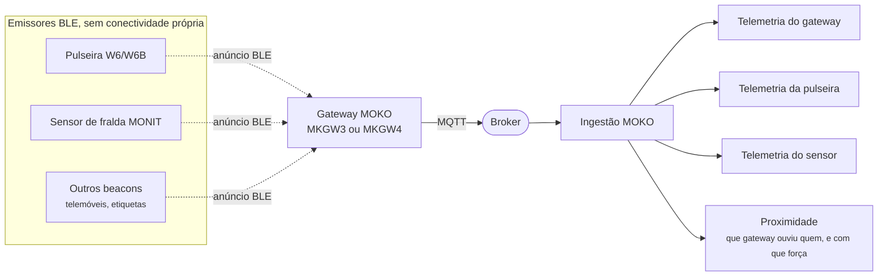
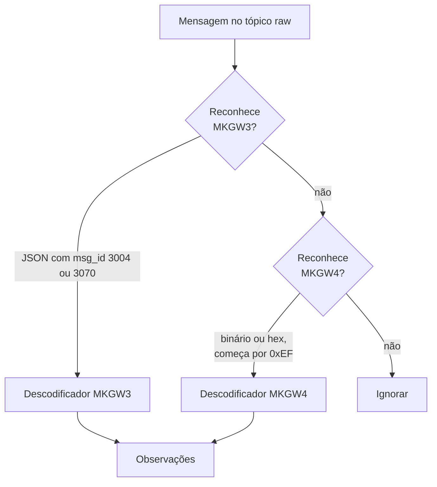
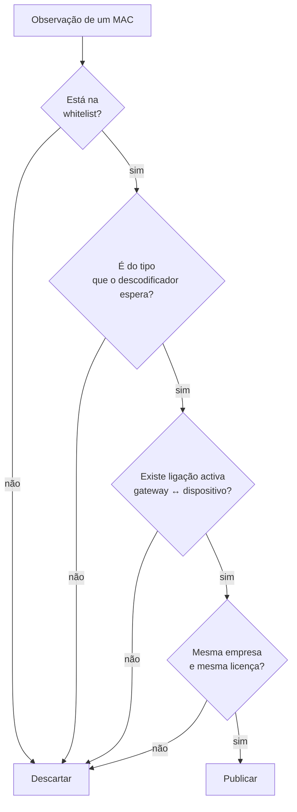

# 05 — Gateways e dispositivos BLE

## Âmbito

As pulseiras e os sensores de fralda não dispõem de conectividade própria: não
têm SIM nem Wi-Fi e não estabelecem qualquer ligação. Limitam-se a **anunciar**,
emitindo periodicamente um conjunto reduzido de bytes com o seu estado, sem
aguardar resposta.

O gateway MOKO é o recetor. Instalado de forma fixa, capta os anúncios BLE ao
seu alcance e publica-os em MQTT. O hub converte esses anúncios em telemetria
atribuída a cada dispositivo emissor, e não ao gateway.



Uma volta que confunde à primeira: **o gateway publica dentro do espaço de
tópicos do próprio hub**, e o hub subscreve-se a si mesmo.

```text
havicare-hub/null/0/gw/{mac}/raw
```

É o tópico que a firmware do gateway está configurada para usar. Não é composto
pelo hub, não leva o prefixo configurável, e o `null/0` não quer dizer que o
gateway não tenha dono — é simplesmente o que está gravado no aparelho. O dono
verdadeiro é resolvido pela whitelist assim que a mensagem chega.

## 1. Dois formatos, o mesmo gateway



### MKGW3 — JSON

Legível à vista. `msg_id` diz o que é (`3004` estado, `3070` relatório de
varrimento) e o MAC do gateway vem em `device_info.mac`.

### MKGW4 — binário tipo-comprimento-valor

Cabeçalho fixo, depois campos que se identificam por uma etiqueta:

```text
EF | 30 A0 | D4 8C 49 F7 90 9C | 01 2C | <campos TLV>
└┬┘ └──┬──┘ └────────┬────────┘ └──┬──┘
 │     │             │             comprimento
 │     │             MAC do gateway
 │     tipo de mensagem
 início
```

Cada campo é `etiqueta (1 byte) + comprimento (2 bytes) + valor`. Quatro tipos
de mensagem são tratados:

| Tipo | O que traz |
|---|---|
| `3004` | Estado do gateway: hora, tipo de rede, qualidade do sinal, tensão da bateria, aceleração, IMEI |
| `3011` | Alarme de bateria fraca, com a tensão: sai como o evento `low_battery`, com `voltageMv` |
| `3089` | GPS do gateway: longitude e latitude ×10⁻⁷, antena, HDOP |
| `30a0`, `30b2` | Relatórios de varrimento: tudo o que o gateway ouviu |

Num relatório de varrimento, cada dispositivo ouvido traz o tipo de beacon, o
MAC, o RSSI, e os dados de anúncio em bruto. O gateway reconhece catorze
famílias de beacon (iBeacon, Eddystone, os vários BXP da MOKO, PIR, ToF…), mas o
hub **não confia nessa classificação** para identificar os aparelhos que lhe
interessam — olha sempre para os bytes do anúncio.

## 2. Identificação dos dispositivos BLE

A regra estruturante desta camada:

> **A identificação assenta sempre no conteúdo do anúncio, nunca isoladamente no
> endereço MAC.**

A maioria dos dispositivos BLE, incluindo telemóveis, usa endereços aleatórios
rotativos com períodos de poucos minutos. O endereço MAC não constitui, por si,
prova de identidade.

Cada observação é oferecida aos descodificadores por ordem, e o primeiro que a
reclamar fica com ela.

### Sensor de fralda MONIT MECS-PRO

O reconhecimento tem **três** verificações encadeadas:

1. O MAC começa por `eec500` — o prefixo do fabricante.
2. Os dados de fabricante começam por `59 00 02 15`.
3. Os três últimos bytes dos 20 de dados **têm de repetir** os três últimos
   bytes do MAC.

Só depois é que os 20 bytes são lidos, e são lidos **bit a bit**, não byte a
byte:

| Bits | Campo |
|---|---|
| 0–2 | tipo de pacote |
| 3–9 | bateria, em percentagem |
| 10 | tipo de alarme |
| 11–12 | força de transmissão |
| 13–15 | estado do acontecimento |
| 16–75 | dez canais de linha de base, 6 bits cada |
| 76–135 | dez canais de leitura, 6 bits cada |

A humidade de cada canal é `leitura − linha de base`, com o mínimo em zero. O
sensor traz a sua própria referência, o que faz com que a mesma fralda molhada
dê o mesmo número em pessoas diferentes.

O contrato completo do que sai daqui, a derivação do estado e a parametrização
da sensibilidade estão no [capítulo do sensor de fralda](17-sensor-de-fralda.md).

### Pulseira W6B

Tem trama de alarme própria. O toque vem no payload, com um **contador
cumulativo** de quantas vezes o botão foi premido, e quatro modos: simples,
duplo, longo, e inatividade.

Bateria com uma subtileza: acima de 100 o valor está em milivolts, abaixo está
em percentagem.

### Pulseira W6

A W6 dispõe de botão, tal como a W6B, mas executa firmware distinto que **não
implementa trama de alarme**. Utiliza seis espaços de anúncio, e o tipo de
acionamento é determinado pelo espaço que é emitido:

| Espaço | Quando anuncia | O que significa |
|---|---|---|
| Aceleração | sempre | presença, movimento, bateria |
| Telemetria (TLM) | sempre | **não é lido** — a bateria vem já na trama de aceleração |
| Identidade | sempre | é esta pulseira |
| `…0011` | 30 s após um toque simples | toque simples |
| `…0012` | 30 s após um toque duplo | toque duplo |
| `…0013` | 30 s após um toque triplo | toque triplo |

Para não ser confundida com qualquer outro beacon Eddystone em alcance, exige-se
que o espaço de nomes seja oito zeros seguidos do próprio MAC.

**Isto é uma convenção de configuração, não algo que o aparelho declare.** Uma
W6 configurada de outra maneira é vista, mas os toques dela não são lidos. Está
assinalado no código e nas notas de arquitetura.

## 3. Ligar um sensor ao gateway certo

Um anúncio BLE é ouvido por todos os gateways ao alcance, e um gateway ouve
tudo, incluindo aparelhos de outros clientes. Antes de publicar seja o que for,
o hub exige **quatro** condições:



A última condição impede a situação mais gravosa: um gateway de uma instalação
captar o sensor de outra e publicá-lo no espaço de tópicos incorreto.

As associações residem na tabela `gateway_device_links` e são geridas pela
dashboard ou pela API.

## 4. Controlo de repetição

Um sensor emite anúncios com intervalos de poucos segundos e é captado
simultaneamente por vários gateways. Sem controlo, o mesmo estado seria
publicado dezenas de vezes por minuto.

| Mecanismo | Função | Âmbito | Omissão |
|---|---|---|---|
| **De-duplicação** | O mesmo anúncio, byte a byte, ouvido outra vez é descartado | sensor de fralda | 5 s |
| **Refrescamento** | Suprime telemetria de conteúdo idêntico até decorrer este período, findo o qual volta a ser publicada | aparelhos MOKO | 60 s |
| **Inatividade do gateway** | Transição para `offline`, com `status` retido. Vale também para um gateway que se calou antes de um reinício do hub: o Redis lembra-se dele | gateways | 180 s |
| **Inatividade do retransmitido** | `device.disconnected` quando nenhum gateway o ouve; o `device.connected` sai quando um o volta a ouvir | aparelhos atrás do gateway | 30 min (`DASHBOARD_DEVICE_IDLE_TIMEOUT_SECONDS`) |

O refrescamento tem âmbito **por gateway** e não por dispositivo. Com âmbito por
dispositivo, o primeiro gateway a publicar suprimiria os restantes, eliminando a
informação de que o sensor é captado em vários pontos.

### Controlo de acionamentos repetidos

Cada tipo de dispositivo exige um mecanismo distinto:

| Dispositivo | Mecanismo | Fundamento |
|---|---|---|
| **W6B** | Contador cumulativo; o acionamento é registado apenas quando o valor se altera | A trama transporta contador |
| **W6** | Janela temporal de 35 s por modo | A trama não transporta contador e repete-se durante 30 s |
| **Fralda** | Transição de estado | O que releva é a mudança de condição, não a repetição |

Na fralda, a sensibilidade configurada entra no **valor** guardado e não na
chave — assim, mudar a configuração conta como uma transição e o estado é
reavaliado logo, em vez de ficar preso ao anterior.

## 5. Proximidade — quem ouviu quem

Além da telemetria de cada aparelho, o hub publica, por cada avistamento, quão
forte o gateway o ouviu. É o que permite a uma aplicação saber em que divisão
alguém está, ou levantar um alarme quando se afasta.

```json
{
  "type": "proximity",
  "data": {
    "gatewayId": "c5e390f30bce",
    "state": "measured",
    "rssiDbm": -74,
    "rssiMaxDbm": -68,
    "rssiMedianDbm": -75,
    "rssiMinDbm": -86,
    "samples": 7,
    "windowSeconds": 5
  }
}
```

Uma janela de 5 segundos, até 10 amostras. Com um número par de amostras, a
mediana é a **menor** das duas do meio — para ser um valor realmente medido, e
não uma média inventada entre dois.

Quando um par gateway–dispositivo se cala mais de 30 segundos, sai **uma vez**
um `state: "unknown"` com `samples: 0`. O silêncio é informação, e sem isto a
última medição ficava a parecer atual para sempre.

### Porque não sai o sinal em bruto

Um sinal de rádio em bruto não é utilizável como limiar. Uma pulseira **parada
em cima de uma secretária**, durante sessenta segundos, produziu quarenta
amostras entre −79 e −64 dBm — quinze decibéis de amplitude sem que nada se
mexesse. Aplicado a um limiar simples, isso dá **dezoito** mudanças de zona por
minuto num aparelho imóvel.

A janela e a mediana existem para remover essa oscilação. Ficam do lado do hub
porque a correção é sobre o sinal, e sobre o sinal o hub é a única camada com
todas as amostras.

**A divisão de responsabilidade é deliberada.** O hub normaliza e publica
fielmente o sinal entre cada dispositivo e cada gateway que o ouve. O alarme —
os limiares, o que conta como «à porta», quem é avisado — pertence a quem
integra. O hub não tem opinião sobre perigo, e as janelas e contagens são
argumentos do `ProximityTracker`, não configuração exposta.

**Avistamentos não reclamados:** quando nenhum descodificador sabe ler uma
trama, mas o MAC pertence a um dispositivo registado e ligado ao gateway, o RSSI
é aproveitado na mesma. Um sensor cujo anúncio o hub não entende continua a
dizer onde está.

## 6. O que não entra no histórico

Os relatórios de varrimento **não** são escritos no histórico da dashboard, e a
proximidade também não. Ambos são publicados no MQTT, mas um gateway que capte
vinte dispositivos esgotaria a lista de 100 entradas em segundos, eliminando o
seu valor de consulta.

## 7. O gateway BLE da Havicare

O MOKO só ouve anúncios. Para os aparelhos que é preciso ligar — a pulseira
Veepoo, a [balança](22-balanca.md), o [tensiómetro](23-tensiometro.md), o
[termómetro](24-termometro.md) e o [oxímetro](25-oximetro.md) — há um gateway por software da Havicare (modelo
`Havicare BLE Gateway`), que se liga ao aparelho, reencaminha o que ele manda e
escreve o que o hub lhe pede. Usa o mesmo espaço de tópicos:

| Sentido | Tópico |
|---|---|
| gateway → hub | `havicare-hub/null/0/gw/{gateway}/raw` |
| hub → gateway | `havicare-hub/null/0/gw/{gateway}/cmd` |

O gateway identifica-se pelo tópico e o aparelho pelo `device.mac`; os dois têm de
estar registados e ligados um ao outro. Um aparelho por registar dá a notificação
de «dispositivo por autorizar», a não ser que esteja na lista de bloqueados.

O `…/gw/+/raw` tem um subscritor só, o do MOKO: uma mensagem com `source` é de
outra ponte, e vai para a que a reclama — pela fonte e, nas JoyTech, pelo prefixo
do modelo (`DBP`, `XM`, `DET`).

O gateway está ligado enquanto publica: o subscritor marca-o como um MOKO e
dá-o por desligado ao fim do mesmo prazo sem mensagens. Sem
aparelhos por perto, só um sinal de vida dele o mantém ligado.

A instância de dev lê os gateways reais. Com `GATEWAY_COMMANDS_ENABLED=false` não
lhes escreve nada ([capítulo 15](15-operacao.md)).

### O que sobe

Todas as mensagens têm o mesmo envelope:

| Campo | O que é |
|---|---|
| `source` | Quem fala: `veepoo-node`, `lefu-torre-node` ou `joytech-node` |
| `kind` | O tipo da mensagem |
| `device` | `mac`, `model` e, quando o gateway os sabe, `firmware` e `rssiDbm`. O `rssiDbm` é o sinal da ligação entre os dois, e dá as barras do par na dashboard, como o de um MOKO |
| `payload` | Os dados do `kind` |
| `tzOffsetMinutes` | O fuso da máquina do gateway, que data o que vem na hora do aparelho |

Cada ponte só lê a sua `source`; a JoyTech separa o tensiómetro, o termómetro e o
oxímetro pelo `device.model` (`DBP…`, `DET…` e `XM…`). Dois `kind` são comuns a todas:

| `kind` | `payload` | O que o hub faz |
|---|---|---|
| `session` | `connected`, e outros campos de cada aparelho (`authenticated` na pulseira, `battery` e `mtu` na balança) | Online e entrega a fila; `connected: false` (ou `authenticated: false`) põe-no offline |
| `command_result` | `dedupeKey`, `commandId`, `operation` e `ok`; `error` quando `ok` é `false`; `step`, o índice da escrita, na balança e na JoyTech; `outcome` só na pulseira | Tira o comando da fila; `ok: false` falha-o com o `error` |

Um comando pode ficar sem `command_result` — na pulseira, uma configuração que não
pegou ou uma operação que o gateway não conhece. Fica na fila, e o hub volta a
mandá-lo até expirar: de 30 em 30 s na pulseira, e de 40 em 40 s na balança e na
JoyTech, mais do que os 30 s de um `await`.

Na balança e na JoyTech sai **uma ordem de cada vez** por aparelho, pela ordem em
que se pediram: a seguinte espera pelo `command_result` da anterior. Um
`not_connected` não falha a ordem: o aparelho já se tinha ido, e ela espera pela
ligação seguinte. Uma sessão de que não se ouve nada há 2 minutos acabou, mesmo sem
o `connected: false`, e um hub reiniciado retoma-a pela primeira trama.

Os outros são de cada aparelho: `frame` na balança e na JoyTech, com a trama em
`hex`, e na pulseira `battery`, `measurement`, `ecg_wave`, `sleep` e
`daily_block`, já descodificados pelo SDK. Estão nos capítulos de cada um.

O gateway antigo da pulseira só manda o `authenticated` na sessão e o `outcome`
no resultado, e o hub continua a aceitá-los: sem `ok`, o `outcome` `no_response`
falha o comando e qualquer outro confirma-o.

### O que desce

```json
{
  "deviceId": "748b34837b1e",
  "commandId": "…",
  "dedupeKey": "…",
  "operation": "readBloodPressureHistory",
  "payload": {"writes": [{"char": "fff2", "hex": "faaaaaaf000a0a14f55f", "await": {"char": "fff1", "prefix": "faaaaaaf000a8b", "timeoutMs": 30000}}]},
  "expiresAt": 1792405140
}
```

Na balança e na JoyTech o `payload.writes` são as escritas GATT, por ordem, já
codificadas pelo hub; o `await` opcional manda o gateway esperar por uma
notificação que comece pelo `prefix` antes de responder. Na pulseira o
`operation` é a operação do SDK (`measure.heartRate.start`,
`config:find_device`) e o `payload` é o valor a escrever.

### Os erros

O `error` de um `command_result` é uma lista fechada, em inglês e snake_case:

| `error` | Quando |
|---|---|
| `not_connected` | O aparelho não estava ligado quando o comando chegou |
| `disconnected` | Desligou-se a meio |
| `write_failed` | A escrita GATT falhou |
| `await_timeout` | A notificação do `await` não chegou a tempo |
| `no_response` | A pulseira não respondeu à operação |

A dashboard traduz-os; um valor fora da lista aparece como veio.

## Diagnóstico

> **A aplicação MKScannerPro tem de estar encerrada antes de qualquer
> verificação no broker.** Um gateway MKGW4 suspende a publicação em MQTT
> enquanto a aplicação lhe estiver ligada.

## Implementação

| Ficheiro | Responsabilidade |
|---|---|
| `src/Ingress/Mqtt/Gateway/GatewayTopic.php` | `…/gw/{mac}/raw` e a forma canónica de um MAC |
| `src/Ingress/Mqtt/Moko/MokoBridge.php` | O subscritor do `gw/+/raw`: identidade, ligações, travões, publicação, e a entrega às outras pontes |
| `src/Ingress/Mqtt/Moko/MokoMessageDecoder.php` | Seleção entre os formatos MKGW3 e MKGW4 |
| `src/Ingress/Mqtt/Moko/Mkgw3MessageDecoder.php` | JSON |
| `src/Ingress/Mqtt/Moko/Mkgw4MessageDecoder.php` | Binário TLV |
| `src/Ingress/Mqtt/Moko/GatewayNormalizer.php` | Telemetria do próprio gateway |
| `src/Ingress/Mqtt/Monit/MonitMecsProDecoder.php` | Os 20 bytes do sensor de fralda |
| `src/Ingress/Mqtt/Monit/MonitNormalizer.php` | Humidade, índice e estado |
| `src/Ingress/Mqtt/Moko/W6bDecoder.php` · `W6Decoder.php` | As duas pulseiras |

As pulseiras Veepoo não passam por um gateway MOKO: falam com o gateway BLE da
Havicare (secção 7), como a balança e a JoyTech.

| Ficheiro | Responsabilidade |
|---|---|
| `src/Ingress/Mqtt/Veepoo/VeepooBridge.php` | Identifica e publica o que o gateway reencaminha |
| `src/Ingress/Mqtt/Veepoo/BraceletPresence.php` | Visto, offline e o histórico de presença |
| `src/Ingress/Mqtt/Veepoo/BraceletContext.php` | O dispositivo resolvido, por mensagem |
| `src/Ingress/Mqtt/Veepoo/DailyBlockNormalizer.php` | Os blocos diários do histórico |
| `src/Ingress/Mqtt/Veepoo/MeasurementNormalizer.php` | As medições pontuais |
| `src/Ingress/Mqtt/Veepoo/SleepNormalizer.php` | As fases de sono |
| `src/Ingress/Mqtt/Veepoo/SettlingReadings.php` | As leituras ainda a estabilizar, que não saem |
| `src/Ingress/Mqtt/Veepoo/MeasurementFailureReporter.php` | A medição que falhou, e porquê |
| `src/Ingress/Mqtt/Veepoo/DownlinkDispatcher.php` | Os comandos em fila para a pulseira |
| `src/Ingress/Mqtt/Moko/BraceletNormalizer.php` | Bateria, movimento e o toque, das duas pulseiras MOKO |
| `src/Ingress/Mqtt/Moko/ProximityTracker.php` | A janela de RSSI |
| `src/Ingress/Mqtt/Gateway/RedisObservationStateStore.php` | De-duplicação, refrescamento, transições |
| `src/Ingress/Mqtt/Gateway/GattDownlinks.php` | As escritas GATT da balança e da JoyTech: uma de cada vez, e o reenvio |
| `src/Ingress/Mqtt/Gateway/GattDeviceContext.php` | O aparelho e o gateway, resolvidos uma vez por mensagem |
| `src/Ingress/Mqtt/Lefu/` | A balança ([capítulo 22](22-balanca.md)) |
| `src/Ingress/Mqtt/JoyTech/` | O tensiómetro, o termómetro e o oxímetro ([23](23-tensiometro.md) a [25](25-oximetro.md)) |

As de `Gateway/` não são MOKO: o espaço de tópicos `gw/{mac}/raw` é do hub, e
o estado de observação serve qualquer gateway que repita — o MOKO relê o anúncio,
o nó Veepoo relê o histórico do dia.

Os manuais do fabricante estão em
[`fornecedores/MOKO/`](fornecedores/MOKO/), com as notas de campo em
[`MKGW4 payloads — hex vs JSON.md`](fornecedores/MOKO/MKGW4%20payloads%20—%20hex%20vs%20JSON.md).
