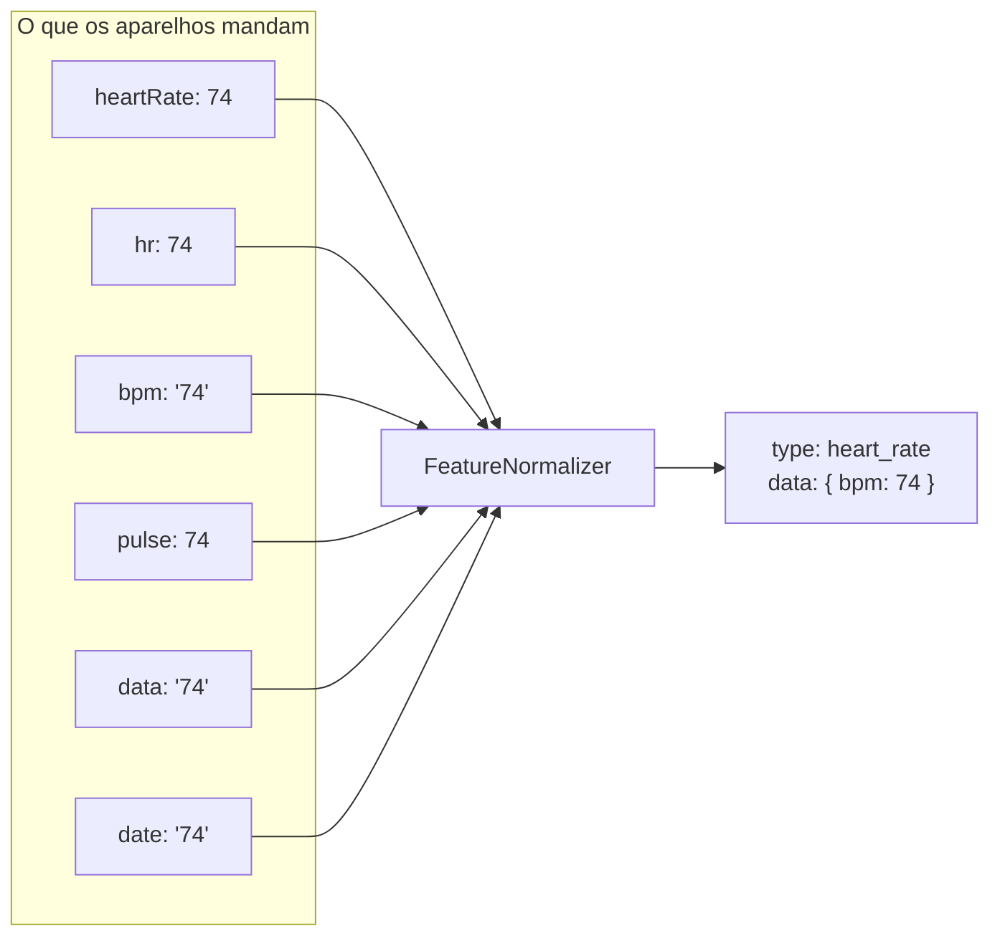
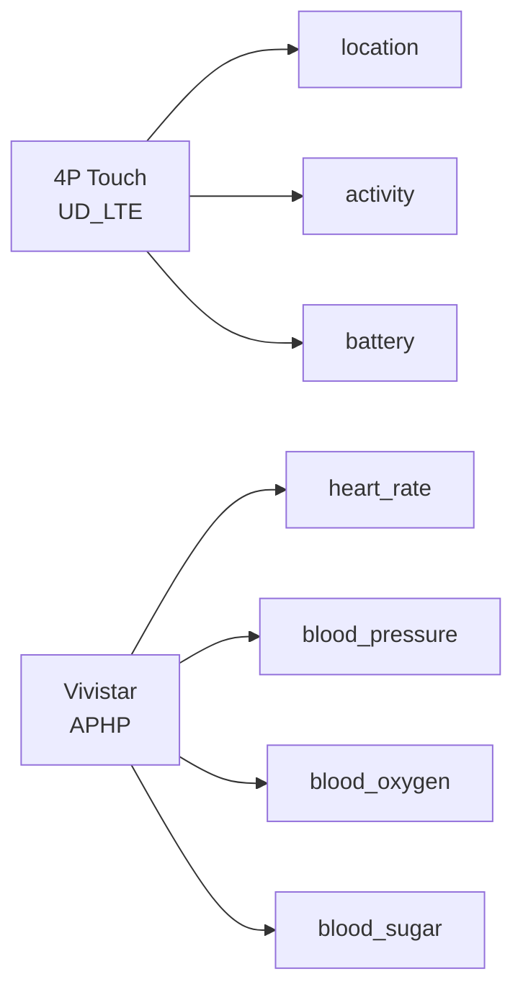

# 06 — Normalização

## Âmbito

A normalização constitui a função central da plataforma e o que a distingue de
um encaminhador.

Os protocolos suportados divergem em todos os aspetos da representação: na
designação dos campos, no tipo dos valores — a temperatura pode chegar em texto
ou em número — e nas unidades, com a bateria expressa em percentagem ou em
milivolts. A normalização converte todos numa forma única, comum a relógios,
radares e sensores BLE.



A designação `date` presente na lista não é um erro de transcrição: existe
firmware que a utiliza no lugar de `data`. O hub aceita ambas, reproduzindo
fielmente o que os dispositivos reportam.

## 1. Famílias de envelope

Nem todas as mensagens publicadas são medições. Há três formas, e distinguem-se
pelo campo que as identifica:

| Forma | Canais | Identificador | Tem `data` |
|---|---|---|---|
| Medição ou acontecimento de domínio | `telemetry`, `events` | `type`, com o nome da capacidade | sim |
| Ciclo de vida | `events` | `type`, começado por `device.` | não |
| Estado | `status` | `state` | não |
| Mensagem original | `raw` | `direction` | conforme a ingestão |

O canal não determina a forma: o `events` transporta tanto um alarme, com `data`
e `source`, como um `device.connected`, que só leva a identidade.

> **O envelope não leva versão de esquema.** O campo `schemaVersion` existiu e
> foi removido: nunca foi lido, e o valor seguia o produtor da mensagem em vez
> do canal, o que o tornava enganador. Versionar é assunto da API; no MQTT o
> contrato mantém-se por não se partir o que já está publicado — acrescentar
> campos é seguro, mudar ou remover não é.

## 2. O envelope de telemetria

```json
{
  "type": "heart_rate",
  "occurredAt": "2026-09-01T10:35:10Z",
  "device": {
    "id": "861265061009822",
    "supplier": "Vivistar",
    "model": "L08 Pro",
    "commercialName": "Vivistar L08 Pro"
  },
  "data": { "bpm": 74 },
  "source": { "protocol": "vivistar-iw", "nativeType": "AP49" }
}
```

| Campo | Notas |
|---|---|
| `type` | O nome da capacidade. A secção 3 lista as reconhecidas pelo `FeatureNormalizer` e as dos ingestores MQTT |
| `occurredAt` | UTC, RFC 3339, **ao segundo**. É o relógio do **hub** no momento de publicar, não o do aparelho |
| `device.id` | Identidade canónica — a mesma que vai no tópico |
| `device.supplier` · `device.model` | O que a whitelist diz. Omitidos se vazios |
| `device.commercialName` | Do catálogo de modelos. Omitido quando o modelo não está lá |
| `data` | A forma partilhada da capacidade |
| `source.protocol` | Quem descodificou: `vivistar-iw`, `wonlex-json`, `four-p-touch`, `voerka-ncs`, `qinglanst-radar`, `moko-mkgw3`, `moko-mkgw4`, `monit-mecs-pro-ble`, `moko-w6`, `moko-w6b`, `tuya-cloud` |
| `source.nativeType` | O tipo original do fabricante: `AP49`, `upHeartRate`, `UD_LTE`, `LK`, `heartbreath`… Nas pulseiras Veepoo é `type-{n}`, o número com que o fabricante numera os seus retornos, ou `daily_block`, `session`, `battery` e `ecg_wave` para o que não tem número |
| `source.gatewayId` · `source.rssiDbm` | Só em BLE: que gateway ouviu, e com que força |
| `source.topic` | Só no radar: o tópico de origem |

### Campo `occurredAt`

Regista o instante da publicação e **não** o da medição. Os anúncios BLE não
transportam data, e um relógio que esteve sem cobertura transmite lotes com
registos antigos. O instante indicado pelo dispositivo, quando existe, fica na
mensagem original do canal `raw`; se vier a ser necessário na forma normalizada,
promove-se a um campo próprio do `data`.

Um instante promovido ao `data` sai na mesma forma do `occurredAt` — UTC, RFC
3339, ao segundo — e é o relógio do aparelho e não o do hub. É o caso do
`startTime` e do `endTime` do sono, do `startedAt` das ondas e do `measuredAt` de
cada intervalo R-R. Um instante em número não entra no contrato:
obriga quem integra a adivinhar a unidade, e o nome do campo não a diz.

## 3. Capacidades

As capacidades reconhecidas pelo `FeatureNormalizer`, que serve os relógios, e as
que o caminho das pulseiras Veepoo acrescenta. **O contrato já documentou doze e
publicava vinte**, e o mesmo voltou a acontecer com as pulseiras: seis tipos
— `met`, `stress`, `blood_lipids`, `uric_acid`, `sleep_apnea` e `cardiac_load` —
saíram no MQTT antes de aparecerem aqui.

Campos ausentes são **omitidos**, nunca preenchidos com `null` ou zero. Uma
leitura que não se consegue normalizar não produz evento nenhum.

**Cada leitura que o aparelho entrega produz o seu evento**, mesmo quando é igual
à anterior. O hub não guarda o valor anterior para decidir se vale a pena dizê-lo:
essa comparação é de quem integra, que tem o que leu da vez passada. Colapsar
repetições mudaria o significado do silêncio — deixaria de se distinguir «não
mudou» de «não houve leitura».

Um nome só por grandeza, igual em todos os tipos que a levam: os passos são
`steps` na `activity` e no `steps`, o HRV é `hrvMilliseconds` no `hrv` e no `ecg`.
A unidade vive no nome do campo, mesmo quando o tipo já a diz — `met.met`,
`hrv.hrvMilliseconds`. Duas capacidades cujos nomes só se
distingam por um sufixo são um sinal de que uma delas já tem nome noutro sítio:
o acumulado do dia é `activity` em toda a frota, e os passos de uma janela são
`steps` com a janela no próprio valor.

### Sinais vitais

| `type` | `data` |
|---|---|
| `heart_rate` | `bpm` |
| `blood_pressure` | `systolicMmHg`, `diastolicMmHg`. O tensiómetro junta `irregularHeartbeat` e `memoryGroup` (1–4), e da memória `fromHistory: true` — ver o [capítulo 23](23-tensiometro.md) |
| `blood_oxygen` | `spo2Percent` |
| `blood_sugar` | `glucoseMgDl` |
| `breath_rate` | `breathsPerMinute` |
| `temperature` | `bodyCelsius`, `surfaceCelsius`, `environmentCelsius`. O termómetro de testa junta `site` (`ear`, `forehead`), e da memória `fromHistory: true` — ver o [capítulo 24](24-termometro.md) |

> **A capacidade `blood_pressure` não inclui a frequência de pulso.** Um valor
> transmitido como `"120/80/74"` é decomposto nos três números, mas o terceiro é
> emitido como evento `heart_rate` **independente**, com o mesmo `nativeType`.
> O campo `pulseBpm` não existe no contrato.

### Formas de onda

| `type` | `data` |
|---|---|
| `ecg` · `ppg` | `samples[]`, `frequencyHz`, `collectionId`, `startedAt`, `block` |
| `hrv` | `hrvMilliseconds` |
| `rr_interval` | `intervals[{measuredAt, rrIntervalMilliseconds}]`, `frequencyHz`, `collectionId` |

Uma grandeza tem o mesmo nome em todos os tipos: o `hrvMilliseconds` e o
`rrIntervalMilliseconds` do `hrv` e do `rr_interval` são os do resumo do `ecg`.

### Atividade e estado

| `type` | `data` |
|---|---|
| `activity` | `steps`, `distanceMeters`, `distanceKm`, `caloriesKcal`, `exerciseSeconds`, `standMinutes` — **o acumulado do dia**, e não um incremento |
| `sleep` | `startTime`, `endTime`, `isAccumulative`, `totalDurationMinutes`, `timingValid`, `segments[]` |
| `battery` | `percent` **ou** `voltageMv`, `charging`, `reportReason`, `mainsPowered`, `lowBattery` — ver a tabela abaixo, que diz quem manda o quê |
| `device_state` | `state`, `reason` |
| `firmware_version` | `version` e, no radar, `communicationVersion` |
| `device_config` | `status` (`ok` · `failed`) e, quando o hub sabe traduzir o que o aparelho diz ter, `settings` com as chaves das configurações do hub |
| `location` | ver a secção 4 |

Os alarmes e alertas — `help_call`, `fall`, `low_battery`, `zone_entry` e os
outros — são eventos, com o tipo do que aconteceu e uma `severity`. A lista e o
`data` de cada um estão no [contrato MQTT](08-contrato-mqtt.md).

#### A bateria, campo a campo

O cartão da bateria junta coisas que vêm de sítios diferentes, e nenhum aparelho
manda tudo. Quem integra tem de contar com a ausência de qualquer um deles.

| Campo | Quem o manda | O que é |
|---|---|---|
| `percent` | todos menos o gateway MKGW4 | A carga, de 0 a 100 |
| `voltageMv` | pulseiras MOKO sem percentagem, e o gateway MKGW4 | A tensão em milivolts. **Alternativa** ao `percent`, nunca vem com ele: converter uma na outra exigia a curva da célula |
| `charging` | relógios Wonlex e o dispensador | Se está a carregar. No dispensador falta quando ele diz que não tem bateria |
| `reportReason` | relógios Wonlex | O motivo do envio: `power_on`, `power_off`, `periodic` ou `low_battery`. É o `batteryType` do fabricante, que apesar do nome não é o tipo da bateria |
| `mainsPowered` | dispensador | Se está ligado à ficha. É outra pergunta: um aparelho cheio e ligado não carrega nada |
| `lowBattery` | relógios 4P Touch e Wonlex, pulseiras Veepoo, dispensador | A bandeira comum de bateria fraca. É sempre o aparelho a dizê-lo, e nunca um limiar nosso sobre a percentagem: o bit 0 do estado no 4P Touch, o `reportReason` `low_battery` na Wonlex, o `lowVoltage` na Veepoo, o `0x8104` a `2` no dispensador. Sem a informação, falta |

O `charging` é o `batteryState` da Wonlex, `0` ou `1`, e no dispensador o `0x8104`
a `3`; os outros estados do dispensador — cheia, fraca — já estão no `percent` e no
`lowBattery`.

Os relógios 4P Touch e Vivistar **não reportam carga** — as especificações dos
dois não têm bit nenhum para ela, só a percentagem e um alarme de bateria fraca.

Quando a bandeira acende sai também o evento `low_battery`, uma vez, e só volta a
sair depois de ela ter apagado.

### Só de alguns tipos de aparelho

| `type` | Quem | `data` |
|---|---|---|
| `presence` | radar | `peopleCount`, `people[]` — ver o [capítulo do radar](04-ingestao-mqtt-radar.md) |
| `sleep_state` | radar | `state` |
| `position_minute_stats` · `vitals_minute_stats` | radar | resumos por minuto, com a unidade em cada campo — ver o [capítulo do radar](04-ingestao-mqtt-radar.md) |
| `steps` | pulseira | `steps`, `periodSeconds` — quantos passos naquela janela. O acumulado do dia é `activity` |
| `wear_state` | pulseira | `state`: `worn` ou `not_worn`, em cada bloco |
| `met` | pulseira | `met` — equivalentes metabólicos, com uma casa decimal; o nome do campo é a unidade |
| `stress` | pulseira | `stressScore` — inteiro, como o fabricante o reporta e a app o mostra |
| `blood_lipids` | pulseira | `totalCholesterolMmolPerL`, `triglyceridesMmolPerL`, `hdlMmolPerL`, `ldlMmolPerL` |
| `uric_acid` | pulseira | `umolPerL` |
| `sleep_apnea` | pulseira | `episodes`, `hypoxiaSeconds` — contagens do bloco, e não leituras por minuto |
| `ecg` | pulseira, tensiómetro HC-6679B | `samples`, `frequencyHz` e, no tensiómetro, `heartRateBpm` (as amostras em unidade por conhecer — [capítulo 23](23-tensiometro.md)); nas pulseiras, `heartRateBpm`, `hrvMilliseconds`, `qtcMilliseconds`, `rrIntervalMilliseconds` — o que o exame apurou, junto com o traçado |
| `sleep_quality` | pulseira | `qualityStars`, `deepSleepScore`, `efficiencyScore`, `fallAsleepScore`, `durationScore`, `nightWakingScore`, `insomniaScore`, `awakeningCount`, `firstDeepSleepMinutes`, `nightAwakeMinutes`, `returnToDeepSleepMeanMinutes` — as pontuações que o firmware atribui à noite |
| `cardiac_load` | pulseira | `cardiacLoad` — sem unidade nem escala documentadas pelo fabricante |
| `find_device` | pulseira | `state`: `searching`, `stopped` ou `timed_out`. A pulseira desiste sozinha ao fim de cerca de um minuto, e é `timed_out` que o diz |
| `body_composition` | pulseira, balança | `bmi`, `bodyFatPercent`, `fatMassKg`, `leanMassKg`, `musclePercent`, `muscleMassKg`, `subcutaneousFatPercent`, `bodyWaterPercent`, `waterMassKg`, `skeletalMusclePercent`, `boneMassKg`, `proteinPercent`, `proteinMassKg`, `basalMetabolicRateKcal`. Na balança é o hub que a calcula, a cada pesagem com impedância medida e um utilizador em linha com sexo, idade e altura (um utilizador atleta fica só com o `bmi`): `bmi`, `bodyFatPercent`, `fatMassKg`, `leanMassKg`, `muscleMassKg`, `musclePercent`, `subcutaneousFatPercent`, `bodyWaterPercent`, `boneMassKg`, `idealWeightKg`, `fatControlKg`, `muscleControlKg`, `weightControlKg` (o que falta para o peso ideal, negativo quando sobra) e `scaleUserId` |
| `weight` | balança | `weightKg`, sempre em quilogramas seja qual for a unidade do visor; `scaleUserId`, o identificador que o hub deu ao utilizador da balança, quando há um em linha: o último que a balança aceitou, que ela guarda entre ligações. Só sai a trama final da pesagem, e a repetida nos 2 s seguintes é ignorada. Do histórico sai com o `occurredAt` da pesagem e `fromHistory: true`; o `heart_rate` e o `body_impedance` seguem a mesma regra |
| `body_impedance` | balança | `impedance50KhzOhm`, `impedance100KhzOhm` (em claro) e, quando a trama `02` chegou na mesma pesagem, `electrodes` (`four` · `four_dual_frequency` · `eight`), `encodedImpedance50Khz` e `encodedImpedance100Khz` — as cifradas são o que o algoritmo da Lefu precisa para a composição corporal |
| `body_impedance_channel` | balança | `channel`, `impedanceOhm`: a impedância em claro canal a canal (trama `03`) |
| `weighing_status` | balança | `weightKg`, `weightPhase` (`idle` · `settling` · `stable` · `overload`), `impedancePhase` e `heartRatePhase` (`idle` · `measuring` · `measured` · `failed`), `displayUnit` (`kg` · `lb` · `jin` · `st` · `st_lb`), `shuttingDown`. Sai só quando muda a fase, e não a cada oscilação do peso |
| `motion` | pulseira | `xMg`, `yMg`, `zMg`, `magnitudeMg` |
| `proximity` | pulseira, sensor de fralda | `gatewayId`, `state`, `rssiDbm`, `rssiMaxDbm`, `rssiMedianDbm`, `rssiMinDbm`, `samples`, `windowSeconds` |
| `connectivity` | gateway, radar, relógio 4P Touch, dispensador | `interface` (`cellular` · `wifi` · `ethernet` · `ethernet_wifi`), `radioType` (a enumeração da `location`), `signalQuality` (CSQ, 0–31), `signalStrengthDbm`; a 4P Touch junta `wifiEnabled`, `wifiConnected` e `cellularEnabled`. No radar vem da leitura `deviceProp`: `wifi` com `signalStrengthDbm`, ou `cellular` com `signalQuality` |
| `tilt` | radar | `xDegrees`, `yDegrees`, `zDegrees`, `factoryCalibrated` — o ângulo do radar com os três eixos; no teto o X e o Y ficam dentro de ±10° |
| `diaper_moisture` · `diaper_moisture_level` · `diaper_condition` | sensor de fralda | ver o [capítulo 17](17-sensor-de-fralda.md) |
| `medication_intake` | dispensador | `alarmSlot` (1–9), `scheduledAt`, `takenAt`, `cellNumber`, `method`: `on_time` · `early` · `late`, `result`: `on_time` · `late` · `abnormal` · `missed` |
| `cells_remaining` | dispensador | `current`, `total`, `remaining`, `level`: `ok` · `low` · `empty`, e `runoutAt` — o `total` é a capacidade do prato, não quantas células vão carregadas, o `level` é o juízo grosseiro do aparelho sobre a mesma contagem, e o `runoutAt` é quando sai a última dose (ISO 8601 no fuso do aparelho; `null` sem plano ou depois do fim do período) |
| `ambient_temperature` | dispensador | `environmentCelsius` — o ar onde a caixa está, e não uma pessoa |
| `ambient_humidity` | dispensador | `humidityPercent` — a humidade do ar onde a caixa está, e não a da fralda |
| `device_fault` | dispensador | `fault`: `rotation` · `tray_reset` · `pusher` · `cell_door` · `keys` |

### Capacidade `sleep`

A normalização do sono aplica validação reforçada, dada a frequência de
inconsistências temporais no firmware dos relógios. O campo `timingValid`
reporta o resultado dessa validação, que exige: instantes compreendidos entre
2000 e 2100, fim posterior ao início, contenção de cada segmento no intervalo
exterior, e concordância entre a duração declarada e as fronteiras, com
tolerância de um minuto.

A validação corre sobre milissegundos, que é a unidade em que os relógios os
entregam; publicados, os instantes da noite e de cada segmento são datas RFC
3339 em UTC.

Em caso de reprovação, os instantes são **removidos** e `timingValid` assume o
valor `false`, mantendo-se os segmentos e a duração total. Um registo com
durações corretas e instantes inválidos conserva utilidade analítica; instantes
inválidos apresentados como válidos não.

Os tipos de segmento são unificados em `deep_sleep`, `light_sleep`, `rem` e
`awake`, independentemente da designação de origem. Um segmento de designação
desconhecida sai sem `type`, e não com a etiqueta do fabricante. A pulseira acrescenta
`insomnia`, que o firmware distingue de `awake`: um é estar deitado sem dormir,
o outro é ter-se levantado.

### O ECG da pulseira

O fabricante documenta um relatório final do exame — média de frequência
cardíaca, respiração, HRV e morfologia do traçado — que se lê do aparelho por
id. **Neste firmware esse relatório não existe:** os quatro tipos de id
documentados devolvem todos `dataId: 0`, e a informação de doença é, de
qualquer maneira, conteúdo pago que sem contrato vem a zeros.

O que há são as tramas de estado, uma por segundo durante a medição. O gateway
recolhe-as e entrega-as com a onda, e o hub resume-as para dentro do mesmo
envelope: um exame é um exame, e a frequência cardíaca que ele apurou não é a
mesma coisa que a leitura solta do sensor ótico.

O resumo é a **mediana** e não a média. Numa medição real vieram um QTc de
712 ms e um HRV de 8 ms no meio de valores na casa dos 120 — o algoritmo a
falhar um complexo, que uma média deixaria entrar no resultado. Os primeiros
segundos trazem a trama inteira a zeros enquanto o sinal assenta, e o `--` é o
sentinela de «sem leitura» do firmware. Com um número par de leituras fica a de
cima das duas do meio, que é um valor medido e não uma média que ninguém leu.

A respiração e a velocidade da onda de pulso vêm nas tramas e **não são
publicadas**: vieram a zero nas trinta e quatro tramas do exame, do princípio ao
fim.

Um pedido de medição dá **uma** leitura: a que o aparelho deu por boa no fim.
Enquanto mede, o firmware manda uma trama por segundo e o valor anda — um só
pedido de frequência cardíaca, numa pulseira ao pulso, deu dezanove leituras
entre 79 e 97. Isso é a medição a assentar, e o resultado é o valor com que ela
assentou, que é o mesmo que a app do fabricante mostra; o caminho todo continua
a sair no `raw`.

A leitura sai quando o gateway confirma o comando, ou por prazo se a confirmação
se perder — o valor foi medido e não pode ir-se com ela. As leituras
instantâneas, os totais do dia e o estado de quem manda a pulseira vibrar, saem
na hora: são contadores que o firmware já tem, sem medição a assentar.

Uma medição pode correr sem produzir nada, e há duas maneiras de isso acontecer.
A pulseira não diz nada — o gateway conta as tramas e reporta `no_response` —,
ou responde a tudo com zeros, que é o firmware a dizer que nunca fixou o sinal:
aí só este lado sabe, porque é aqui que se decide o que conta como leitura, e a
razão é `no_reading`. Nos dois casos o pedido fecha-se com a razão em vez de ser
dado por cumprido; sem isso ficava «confirmado» e vazio no ecrã, e confirmado
passava a querer dizer «o gateway mandou» em vez de «a pulseira mediu».

### O sono da pulseira

A pulseira não reporta o sono como os relógios. Guarda três noites já
calculadas pelo firmware e reproduz cada uma quando lhe pedem, com uma curva de
um caractere por intervalo — `0` profundo, `1` leve, `2` REM, `3` insónia, `4`
acordado — e os totais de cada fase à parte.

Os segmentos saem da curva, e a duração de cada intervalo é a noite a dividir
pelo número deles: o fabricante não a declara, e fixá-la em cinco minutos punha
a curva a discordar dos instantes que a própria trama traz. Quando os instantes
não são de confiar, os segmentos passam a ser os três totais — sem `startTime`
nem `endTime`, mas com as durações de pé.

O firmware data a noite com mês, dia, hora e minuto, sem ano. O ano é o da
leitura, recuado um se isso puser a noite no futuro — sem o que o sono de 31 de
dezembro lido a 1 de janeiro ficava onze meses à frente.

As sete pontuações saem como `sleep_quality` e não dentro do `sleep`: são um
juízo sobre a medição e não a medição, e nenhum relógio pontua o sono. Os nomes
do hub dizem o que medem, ao contrário dos do fabricante — `nightScore` é a
pontuação das idas à casa de banho (`nightWakingScore`), `nightTotalTime` é
quanto tempo se esteve levantado (`nightAwakeMinutes`), e `sleepQuality` conta de
0 a 4 onde a app mostra uma a cinco estrelas (`qualityStars`, 1 a 5).

## 4. Capacidade `location`

Uma posição pode ter origem em GPS, em antenas de rede móvel, em pontos de
acesso Wi-Fi, ou numa combinação destes. Os fabricantes divergem na designação
dos campos, no sistema de coordenadas e na representação da ausência de posição,
frequentemente codificada como `0,0`.

```json
{
  "source": "cell_wifi",
  "hasCoordinates": true,
  "lat": 41.706841,
  "lon": -8.793279,
  "gpsValid": false,
  "radioType": "lte",
  "coordinateSystem": "wgs84",
  "reportKind": "periodic",
  "accuracyMeters": 48.0,
  "baseStations": [ { "mcc": "268", "mnc": "01", "lac": "…", "cellId": "…", "signalStrengthDbm": -83 } ],
  "wifiAccessPoints": [ { "mac": "dc:fe:23:36:57:4d", "signalStrengthDbm": -61 } ]
}
```

Cinco regras de normalização:

- **A posição `0,0` é eliminada.** Quando `gpsValid` não é verdadeiro e a
  posição é exatamente zero, as coordenadas são removidas. Trata-se da
  codificação usada pelos relógios para indicar ausência de fixação, e a sua
  publicação situaria o dispositivo no golfo da Guiné.
- **O campo `source` é derivado e não copiado.** Assume os valores `gps`,
  `cell`, `wifi` ou `cell_wifi`, determinados pela evidência efetivamente
  presente na mensagem e não pela declaração do fabricante.
- **O campo `hasCoordinates` é o indicador de validade.** Um evento de
  localização sem coordenadas é publicado na mesma, com as antenas e os pontos
  de acesso disponíveis para resolução posterior.
- **Os endereços MAC são normalizados** para `aa:bb:cc:dd:ee:ff` em minúsculas.
- **O campo `signalStrengthDbm` só é aceite com valor negativo.** Um valor
  positivo indica outra escala de medida.

Os números levam a unidade no nome: `speedKmh`, `headingDegrees`,
`altitudeMeters`, `accuracyMeters`, `signalStrengthDbm`, e o `satelliteCount` é
uma contagem. A força do sinal só sai em dBm: o que os relógios mandam noutras
escalas — percentagem, `rxlev` — fica no `raw`.

Os vocabulários fechados: `radioType` assume `gsm`, `wcdma`, `lte`, `cdma` ou
`nr`; `coordinateSystem` assume `wgs84`, `gcj02`, `bd09`, `google` ou `tencent`;
`reportKind` assume `periodic`, `requested`, `alarm` ou `replay`.

Os eventos de `location` são subsequentemente submetidos ao enriquecimento
descrito no capítulo
[Localização sem GPS](12-localizacao-sem-gps.md).

## 5. Eventos múltiplos por mensagem

Uma mensagem nativa não corresponde a uma única medição, mas a **zero ou mais**.



Os eventos originados na mesma mensagem partilham os valores de `occurredAt` e
de `source.nativeType`, par que constitui a chave de correlação.

## 6. Catálogo de capacidades

O `FeatureNormalizer` determina o que a plataforma **normaliza**. O
`CapabilityCatalog` determina o que cada tipo de dispositivo **declara
suportar**, e é este que a API devolve em `capabilities` e que a dashboard
apresenta na matriz por modelo.

Quem publica cada capacidade é facto dela, e declara-se no ficheiro de
definições do tipo de aparelho — não numa lista por protocolo. Por omissão, uma
leitura ou um acontecimento é publicado por todos os protocolos desse tipo de
aparelho, e uma configuração por nenhum; o `publishedBy` escreve as exceções,
que são a diferença entre fornecedores do mesmo aparelho:

```php
// Em WatchCapabilityDefinitions
'connectivity' => ['four-p-touch'],          // sai na resposta ao `TS`
'ppg' => ['wonlex-json'],                    // as outras não medem ondas
'firmware_version' => [],                    // só como resposta a um pedido
```

O `telemetryKeysForProtocol` e o `protocolSpecificKeys` do `CapabilityCatalog`
saem daqui.

São listas distintas. Uma capacidade publicada é **deliberadamente** excluída do
catálogo:

| `type` publicado | Fundamento da exclusão |
|---|---|
| `device_config` | Confirmação de uma configuração, não leitura |

Os relógios não publicam sinal de vida: o que o `heartbeat` deles traz sai como
`battery` e `activity`, e o estado da ligação é o canal `status`.

O catálogo na base de dados segue o código a cada arranque: uma capacidade que o
código declare passa a existir na tabela `capabilities`, e é associada aos
modelos cujo protocolo a publica (ver a [persistência](14-persistencia.md)).

## Implementação

| Ficheiro | Responsabilidade |
|---|---|
| `src/Device/FeatureNormalizer.php` | As capacidades dos relógios e as suas formas |
| `src/Device/DeviceEventDecoder.php` | Tipo nativo → capacidades, por protocolo |
| `src/Device/DeviceEventPayloadBuilder.php` | Monta o envelope das medições e dos alarmes |
| `src/Device/RawPayload.php` | Monta os envelopes de `raw`, `status` e ciclo de vida |
| `src/Domain/Capability/CapabilityCatalog.php` | O que cada tipo de aparelho declara ter |
| `src/Ingress/Mqtt/*/…Normalizer.php` | O mesmo trabalho, do lado do MQTT |
