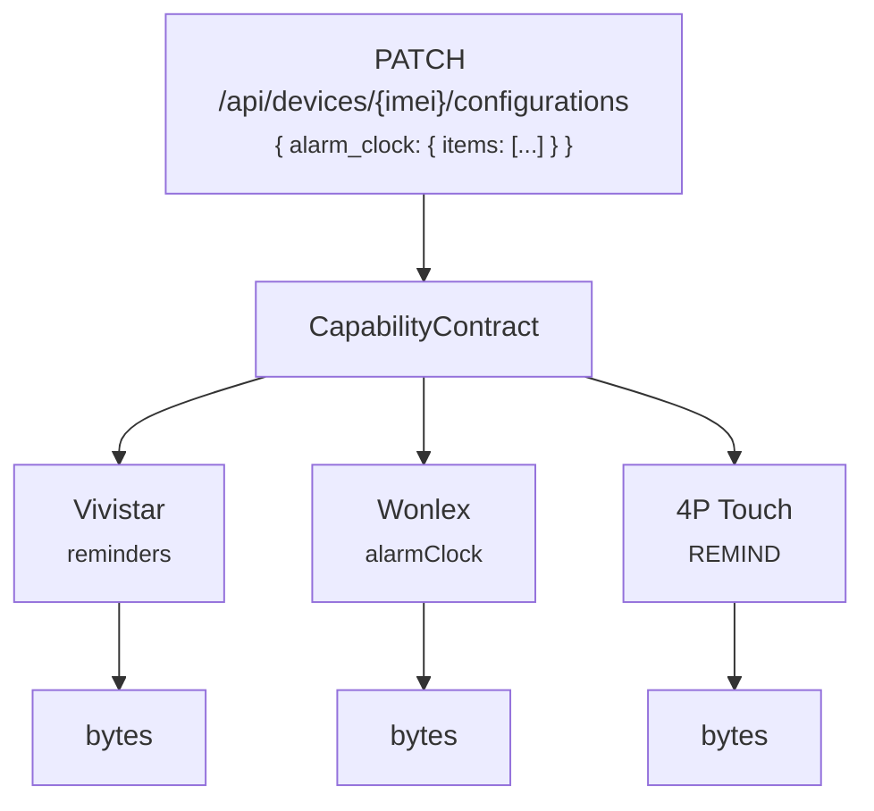
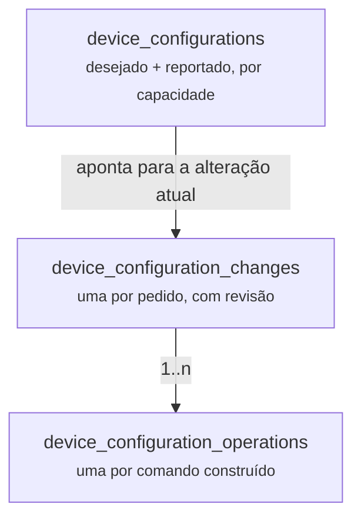
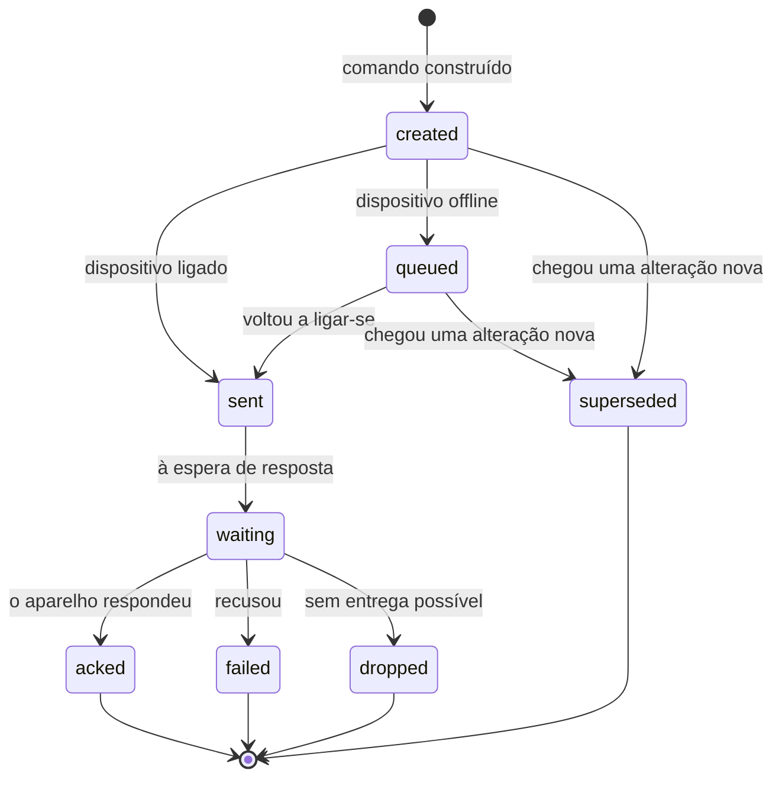

# 10 — Configuração de dispositivos

## Âmbito

A configuração de um dispositivo não se resume à escrita de um valor. Implica a
emissão de um comando através de uma ligação que pode estar fechada, a espera
pela resposta e a determinação posterior de se a configuração foi efetivamente
aplicada.

Entre o estado solicitado e o estado em vigor no dispositivo existe uma
divergência que pode persistir durante horas. O modelo de dados representa
explicitamente essa divergência.


A isso junta-se um segundo problema: os fabricantes não concordam em nada. Um
despertador chama-se `reminders` na Vivistar, `REMIND` na 4P Touch e `alarmClock`
na Wonlex — e as três listas têm formatos que não se parecem.

## 1. Capacidades genéricas

A API só fala em **nomes genéricos**. `alarm_clock`, `sos_contacts`,
`call_whitelist`, `medication_reminders`, `fall_detection`. Quem integra nunca
vê um nome de protocolo.



Cada capacidade complexa é um objeto que sabe traduzir nos dois sentidos:
genérico → nativo para enviar, nativo → genérico para responder. As simples —
interruptores, números, telefones — caem numa implementação genérica.

A tradução precisa de saber o **protocolo** nas duas direções, e não só na de
ida: a mesma chave nativa quer dizer coisas diferentes em fabricantes
diferentes. A Wonlex e a 4P Touch chamam ambas `alarmClock` a listas com
formatos incompatíveis. Sem o protocolo, descodificar é adivinhar.

**Chaves nativas nunca aparecem na API.** Um pedido com `configs` ou com nomes de
protocolo é recusado.

## 2. As três tabelas

O estado de configuração vive em três tabelas, e cada uma responde a uma
pergunta diferente:

| Tabela | Responde a |
|---|---|
| `device_configurations` | Qual é o estado atual de cada capacidade, por dispositivo |
| `device_configuration_changes` | Que alterações foram pedidas, e em que pé estão |
| `device_configuration_operations` | Que comandos concretos foram construídos para as entregar |

Uma alteração pode dar **várias** operações: uma lista de dez alarmes pode ser
dez comandos, e a alteração só está confirmada quando todos estiverem.



### Revisões

Cada alteração incrementa `desired_revision`. Quem responde «este dispositivo
está atrasado?» é o `sync_status` da alteração apontada pelo
`current_change_id`, e não uma segunda revisão.

## 3. O ciclo de vida de uma operação



O estado da **alteração** é derivado do de todas as suas operações:

| Se alguma operação está… | A alteração fica |
|---|---|
| `failed` ou `dropped` | `failed` |
| `created` ou `queued` | `pending_delivery` |
| `sent` ou `waiting` | `awaiting_ack` |
| todas `acked` | `confirmed` |

Existe um quinto estado, **`confirmation_unavailable`**: todas as operações
foram confirmadas, mas o modo de confirmação é `ack_only`, no qual o dispositivo
acusa a receção sem confirmar a aplicação. A distinção face a `confirmed` evita
declarar uma confirmação que o protocolo não fornece.

O modo `ack_only` aplica-se a um único caso: a medição automática de saúde da
Vivistar (`BP86`), cuja resposta `AP86` só acusa a receção.

### Supersessão

Uma alteração nova à mesma capacidade **substitui** a anterior. As operações da
antiga que ainda não saíram são marcadas `superseded` e nunca chegam a ser
enviadas — não faz sentido entregar uma configuração que já foi substituída.

A verificação acontece no momento de esvaziar a fila, logo depois de o aparelho
se autenticar.

## 4. O que a API devolve

`GET /api/devices/{imei}` traz quatro vistas do mesmo assunto:

| Campo | O que é |
|---|---|
| `capabilities` | O que o **modelo suporta**, com metadados para a interface |
| `configurations` | Os valores genéricos **desejados** |
| `effectiveConfigurations` | Os que o aparelho **confirmou** |
| `configurationSync` | A distância entre os dois, com estados e operações |

A distinção que mais confunde: **`capabilities` não é o que está guardado.** É o
que o modelo sabe fazer e o que a API aceita. Um dispositivo acabado de registar
já traz as capacidades todas, com valores por omissão.

As secções escrevíveis são `health`, `contacts`, `alarms` e `settings_system`.
A secção `telemetry` é **só de leitura** — descreve o que se pode medir:

```json
{
  "capabilities": {
    "telemetry": {
      "heart_rate": { "supported": true, "requestable": true },
      "location":   { "supported": true, "requestable": true }
    }
  }
}
```

As entradas escrevíveis trazem ainda `value`, com o valor público atual — o de
partida, quando nada foi guardado, e é o `ConfigurationInputDefaults` quem o
decide —, e `_meta`, com as opções e os limites que uma interface precisa para
as desenhar. **Nenhuma entrada pública expõe identidade de protocolo** — os
nomes nativos só aparecem nas `operations[]` da resposta a um `PATCH`.

### O texto é de quem desenha

A API e o MQTT levam só chaves, enumerações e códigos de erro ingleses. O nome
de uma capacidade, a ajuda de uma configuração, a frase de confirmação de uma
acção destrutiva (o `risk: "destructive"` do catálogo), o nome de cada opção e
o texto de cada botão (o `verb` e os `actions` são enumerações: `read`,
`factory_reset`, `send_message`, `start`, `stop`, `vibrate`) vivem no
dicionário da dashboard, o `src/Dashboard/dashboard/pt-PT.json`, chaveados pela
capacidade e, onde o mesmo nome faz coisas diferentes, pelo protocolo. O
`PortugueseDictionaryTest` falha quando o catálogo ganha uma chave sem tradução.

### A forma pública da Wonlex, do 4P Touch e da Vivistar

| Configuração | Campos |
|---|---|
| Interruptores da Wonlex | `enabled`, e não `switchState` |
| `location_reporting_interval` (Wonlex) | `intervalSeconds` |
| Intervalos de medição (Wonlex) | `intervalMinutes` |
| `low_battery_alert` (Wonlex) | `thresholdPercent` |
| `blood_oxygen_alert` (Wonlex) | `enabled`, `thresholdPercent` |
| `temperature_high_alert`, `temperature_low_alert` | `enabled`, `thresholdCelsius` |
| `blood_pressure_alert` | `enabled`, `systolicMmHg`, `diastolicMmHg` |
| `heart_rate_high_alert`, `heart_rate_low_alert` | `enabled`, `thresholdBpm`, `exerciseEnabled`, `exerciseMinBpm`, `exerciseMaxBpm`, `exerciseThresholdBpm` |
| `sleep_monitoring` (Wonlex) | `enabled`, `startTime` e `endTime` em `HH:MM`, `targetMinutes` |
| `sound_profile` (4P Touch) | `mode`: `ring_and_vibrate`, `ring`, `vibrate`, `silent` |
| `language_timezone` (4P Touch) | `language` em etiqueta BCP 47 (`pt`, `en`, `zh-Hans`…) e `utcOffsetHours` |
| `working_mode` (Vivistar) | `mode`: `normal` (15 min), `power_saving` (60 min), `emergency` (1 min, com GPS) e `custom`, que leva `intervalSeconds` (≥ 30) e `gpsEnabled` |

Nos alertas da Wonlex há campos opcionais, os que a especificação marca com
`[*]`: o limiar do `blood_oxygen_alert` e dos dois de temperatura, o
`systolicMmHg` e o `diastolicMmHg` do `blood_pressure_alert`, e todos os seis
dos dois alertas de ritmo cardíaco, `enabled` incluído. O que falta não vai no
`configs` — nem como 0 nem como `null` — e o relógio fica com o que tinha; o que
vem é validado como sempre. O `thresholdPercent` do `low_battery_alert` não é
opcional. No `sleep_monitoring` são opcionais, da mesma maneira, o `startTime` e
o `endTime`; o `enabled` e o `targetMinutes` são obrigatórios.

O construtor de cada protocolo traduz para o fio: `switchState`, `RemindValue`,
`hpWarn`, `HHmmss`, os códigos do `LZ`, do `profile` e do `BP33`.

Um campo numérico traz no `_meta` os limites que o hub aplica — os mesmos que
recusam um `PATCH` fora deles com `invalid_config`:

```json
"location_reporting_interval": {
  "value": { "intervalSeconds": 600 },
  "_meta": { "intervalSeconds": { "min": 60, "max": 65535 } }
}
```

Só se publica o que a especificação do fabricante dá. Onde ela não dá máximo —
a Wonlex em todos os números, o Vivistar na medição automática — sai só o
`min`, e é 0. O valor de um `PATCH` é sempre a forma pública: um `data` ou um
`fields` com a trama nativa é recusado.

A reposição de fábrica (`reset_device`) só a pede um `hub_admin`. A um
`license_client` responde `403 forbidden`: o aparelho volta a apontar para o
servidor do fornecedor e o hub perde-o.

O `push_message` é só da Vivistar e da 4P Touch. A Wonlex documenta um
`msgNotice`, mas deixa a apresentação ao desenho de cada aparelho, e o HW20Pro
nem a mostra nem lhe responde, embora confirme os outros comandos na mesma
sessão.

O nome de um contacto da Wonlex vai cortado a cinco caracteres, e o `_meta` da
lista telefónica anuncia `name.maxLength: 5`. A especificação não fixa limite;
o número vem do HW20Pro, que num teste de 22/10/2026 recebeu «Rodrigo Al» e
mostrou só os cinco primeiros.

### Pedir uma medição

```http
POST /api/devices/{imei}/requests
{ "feature": "heart_rate" }
```

O nome é genérico. O cliente **não** deve depender de identificadores nativos
como `BPXL` ou `dnHeartRate` — o hub escolhe o comando certo para o protocolo
daquele aparelho e, mais tarde, a medição sai normalizada no MQTT.

Que capacidades se podem pedir num dado dispositivo lê-se em
`capabilities.telemetry.{feature}.requestable`.

### Alterar configurações

```http
PATCH /api/devices/{imei}/configurations
{
  "configurations": {
    "alarm_clock": {
      "items": [
        { "time": "08:10", "enabled": true, "type": 2,
          "recurrence": { "kind": "custom", "days": [1, 3, 5] } }
      ]
    },
    "working_mode": { "mode": "custom", "intervalSeconds": 60, "gpsEnabled": true }
  }
}
```

A resposta traz as chaves alteradas, cada uma com as `operations[]` que foram
criadas para as entregar — incluindo o `nativeKey` de cada uma, que é onde a
identidade de protocolo aparece, e só ali.

Um valor igual ao que o hub tem guardado não volta a sair. Para repor no aparelho
uma configuração que ele perdeu, a capacidade leva `"resync": true` ao lado do
valor: o hub deixa de confiar no próprio registo e envia-a na mesma. O `resync`
não fica guardado.

### Uma capacidade a fundo: `alarm_clock`

Serve de exemplo do padrão que todas seguem. A resposta do
`GET /api/devices/{imei}` traz a capacidade em dois sítios com papéis distintos:

| Onde | O que é |
|---|---|
| `capabilities.reminders.alarm_clock` | O que o **modelo** suporta, presente mesmo sem configuração guardada |
| `configurations.alarm_clock` | O que está **guardado** para aquele dispositivo |

O `_meta` da capacidade descreve o que a interface pode oferecer, e é ele que
absorve as diferenças entre fabricantes:

```json
{
  "value": [ { "time": "08:10", "enabled": true } ],
  "_meta": {
    "limit": 3,
    "recurrence": { "options": ["once", "daily", "custom"] },
    "days": { "options": [1, 2, 3, 4, 5, 6, 7] },
    "type": { "options": [1, 2, 3] },
    "label": { "supported": true },
    "url": { "supported": true, "schemes": ["http", "https"] }
  }
}
```

| Fabricante | Particularidade |
|---|---|
| Vivistar | O `type` é obrigatório no `PATCH` |
| 4P Touch | O `type` não é suportado, e enviá-lo é recusado |
| Wonlex | Aceita `label` e um `url` de áudio, e só `daily` ou `custom` — o protocolo dele é uma máscara semanal |

**Nada disto se lê no código do cliente.** O que estiver ausente do `_meta` não
é suportado naquele dispositivo, e o `limit` diz quantas entradas cabem. Um
`items` vazio é válido e apaga os alarmes guardados.

### Uma capacidade partilhada por dois protocolos: `medication_reminders`

Os dois aparelhos que lembram medicação — o relógio 4P Touch e o dispensador
M228 — falavam formas públicas diferentes com a mesma chave. Hoje
**um plano é um medicamento com as suas horas**, e lê-se sem saber o fornecedor:

```json
{
  "plans": [
    {
      "name": "Paracetamol",
      "doseCount": 2,
      "startDate": "2026-10-01",
      "endDate": "2026-10-10",
      "times": [
        { "time": "08:00", "enabled": true, "recurrence": { "kind": "daily" } }
      ]
    }
  ]
}
```

O núcleo de um plano é `name`, `doseCount`, `startDate`, `endDate` e `times`; o
de uma hora é `time`, `enabled` e `recurrence`. **O que um fornecedor não sabe
omite-se**, como em todo o contrato: o M228 e o 4P Touch não agrupam por
medicamento e dão um plano por lembrete.

No M228 cada compartimento é um plano com uma hora, e o `name` é o medicamento
dele. **O nome fica no hub**: guarda-se no desejado, volta no `GET
/api/devices/{imei}`, e nunca vai ao aparelho, que só sabe horas. Um `PATCH` que
só muda nomes, sobre horas que o aparelho já confirmou, fica aplicado logo e sem
comando — o `configurationSync` dá-o como `confirmed`. Sobre horas ainda por
confirmar, vai ao aparelho como qualquer outra alteração, para não dar por
aplicada a hora que ele ainda não confirmou. O `name` é texto até 64 caracteres;
vazio, omite-se.

```json
{ "plans": [
  { "name": "Metformina",
    "times": [{ "time": "08:00", "enabled": true, "slot": 1, "recurrence": { "kind": "daily" } }] }
] }
```

O resto é extensão de fornecedor, e sai declarada no `_meta`:

| Campo | Onde | O que é |
|---|---|---|
| `slot` | M228, na hora | O compartimento que abre |
| `reminderText` · `voiceData` | 4P Touch, ao lado dos planos | O texto e o áudio do lembrete |

O `slot` **não se adivinha da hora**: é um campo do aparelho.

A Wonlex documenta um `dnMedicationPlan`, mas o HW20Pro ignora-o: não responde
e o lembrete não toca, embora confirme os outros comandos na mesma sessão. Por
isso a capacidade não existe no protocolo `wonlex-json`.

## 5. Configuração de uma pulseira

A pulseira difere do relógio em dois pontos que se notam aqui.

O primeiro é que **grande parte do que ela mede depende de estar configurada para
o fazer**. Um relógio que não mede é um relógio a quem ninguém pediu nada; uma
pulseira que não mede pode estar apenas com a monitorização desligada, e o
resultado é uma série vazia indistinguível de uma avaria. A janela do oxigénio de
dia inteiro é o caso exemplar: com a monitorização ligada mas a janela a
`00:00–00:00`, o aparelho responde sempre um registo de zeros.

O segundo é que a tradução para a forma do fabricante **não acontece no hub**.
O payload viaja genérico até ao gateway que detém a sessão BLE, e é o SDK que lá
corre que monta as tramas. O construtor do hub valida, e só isso:

| Entrada | Campos | Configurações que a usam |
|---|---|---|
| `toggle` | `enabled` | As nove monitorizações do comando `0xB8` |
| `windowToggle` | `enabled`, `range` | Oxigénio de dia inteiro |
| `heartRateThresholds` | `enabled`, `maxBpm`, `minBpm` | Alerta de frequência cardíaca |
| `number` | `level` | Tom de pele |
| `personalInfo` | altura, peso, idade, sexo e as duas metas | Dados para cálculo |

A janela é escrita como `HH:MM-HH:MM`, o mesmo formato do `timeRange` dos
relógios, e apresentada como dois campos de hora para não se poder escrever uma
que não existe.

### O que fica de fora, e porquê

A pulseira deixa configurar bastante mais do que isto: alarmes, oito lembretes
com janela e intervalo próprios, o ecrã que acende ao levantar o pulso, o sistema
de unidades. **Nada disso altera uma leitura.** É comportamento de relógio de
pulso, e não de sensor.

O critério é esse: o hub configura o que o aparelho **mede** e como **calcula**.
Uma configuração que não muda telemetria não pertence a uma API de integração de
saúde — é ruído para quem integra, e mais uma superfície para manter.

O **tom de pele** e os **dados para cálculo** não são preferências de quem usa a
pulseira: entram nas contas do aparelho. O tom de pele regula a potência do LED do
sensor ótico, de que saem a frequência cardíaca, o oxigénio, a variabilidade, a
tensão e o stress; a altura, o peso, a idade e o sexo entram no cálculo das
calorias e da composição corporal. Configurados a valores de fábrica, a telemetria
sai calibrada para um corpo que não é o de ninguém.

A confirmação **relê o aparelho**. O `command_result` do gateway sai só depois de
a leitura devolver o que foi pedido; quando não devolve, o gateway não confirma e
a operação segue o caminho normal de quem não teve resposta — repetição e, no
fim, expiração.

Esta distinção não é teórica. Confirmar a execução dava por aplicada uma
configuração que o aparelho tinha aceitado e ignorado, que é pior do que a dar
por falhada: o estado desejado e o estado em vigor divergiam com os dois a
dizerem-se iguais.

> Ficou registado, para quem lá volte: a escrita dos lembretes do comando `0xE7`
> é recusada pela MF91 através do SDK do fabricante. A trama sai correta, o
> aparelho responde, e mantém os valores que já tinha — a leitura devolve `01` no
> byte de estado e a escrita devolve `00`. A aplicação do fabricante consegue
> alterá-los, portanto é limitação do SDK e não do aparelho. Não foi perseguida
> porque estes lembretes não alteram nenhuma medição.

## 6. Configurações que o hub aplica

Duas configurações **não viajam para o aparelho**: mudam uma regra da ingestão,
são confirmadas logo, e ficam na mesma tabela das outras. Quem decide se algo
viaja é cada capacidade (`HubAppliedCapability`), não o protocolo inteiro — é por
isso que o MONIT e os gateways MOKO declaram catálogo de configuração sem
aceitarem downlink.

### Sensibilidade do sensor de fralda

O sensor MONIT não aceita comandos; a sensibilidade é aplicada pelo hub ao
interpretar os canais de humidade. Os dois parâmetros, os três perfis e a forma
como entram na derivação do estado estão no [capítulo do sensor de
fralda](17-sensor-de-fralda.md).

### Alarme de proximidade do gateway

`proximity_alert`, nos gateways MOKO (`moko-mkgw3`, `moko-mkgw4`). Diz quando um
dispositivo que o gateway retransmite, perto dele, dá o evento
[`proximity_alarm`](08-contrato-mqtt.md#os-tipos). O hub não sabe onde o gateway
está — uma porta, a entrada de um prédio, um teto — e por isso o alarme não fala
em porta.

| Campo | Valores | Por omissão |
|---|---|---|
| `mode` | `off` · `calibrating` · `active` | `off` |
| `devices` | `"all"` ou a lista de identificadores, dos ligados ao gateway | `"all"` |
| `triggerDbm` | −100 a −30 | −58 |
| `minSamples` | 1 a 10 | 3 |
| `cooldownSeconds` | 0 a 3600 | 60 |

- **Dispara** quando o máximo da janela do `ProximityTracker` chega ao
  `triggerDbm`, com pelo menos `minSamples` leituras. O máximo e não a mediana:
  uma passagem rápida dá uma ou duas leituras fortes, e o ruído quase só atenua
  ([capítulo dos gateways](05-gateways-ble.md#5-proximidade--quem-ouviu-quem)).
- **Uma vez por par** (dispositivo, gateway) em cada `cooldownSeconds`: quem fica
  parado ao pé do gateway não dá um alarme por segundo. A contagem vive na memória
  do processo, e um reinício recomeça-a.
- **`calibrating`** avalia igual mas não publica nada: marca o avistamento, e a
  dashboard mostra «Dispararia» ao lado do dispositivo na página do gateway
  durante um minuto. Serve para passar junto ao gateway e acertar o limiar no
  sítio onde ele está.
- **Quem pode disparar** são só os dispositivos ligados ao gateway, que têm a
  mesma empresa e licença. Com uma lista, só esses; um dispositivo ligado depois
  entra em `"all"` sozinho e fica fora da lista até ser escolhido.
- A configuração lê-se na ingestão com cache de 5 s, que é quanto demora uma
  alteração pela API a valer.

## Implementação

| Ficheiro | Responsabilidade |
|---|---|
| `src/Domain/Capability/CapabilityContract.php` | O contrato dos dois sentidos da tradução |
| `src/Domain/Capability/CapabilityRegistry.php` | Que capacidades têm implementação própria |
| `src/Domain/Capability/CapabilityCatalog.php` | A identidade pública e o suporte por protocolo |
| `src/Domain/Capability/Definition/*.php` | O que cada tipo de aparelho declara, e quem o publica |
| `src/Command/DeviceConfigurationCatalog.php` | As definições nativas, por fabricante |
| `src/Command/Configuration/Payload/*.php` | Construir o corpo de cada comando |
| `src/Api/Services/DeviceConfigurationUpdateService.php` | O `PATCH`: validar, traduzir, criar operações |
| `src/Infrastructure/Persistence/Repository/DeviceConfigurationRepository.php` | As três tabelas e a derivação do estado |
| `src/Api/Services/ConfigurationSyncStatus.php` | Desejado contra reportado |
| `src/Domain/Capability/AlarmClock/*.php` | A capacidade `alarm_clock`, por fabricante |
