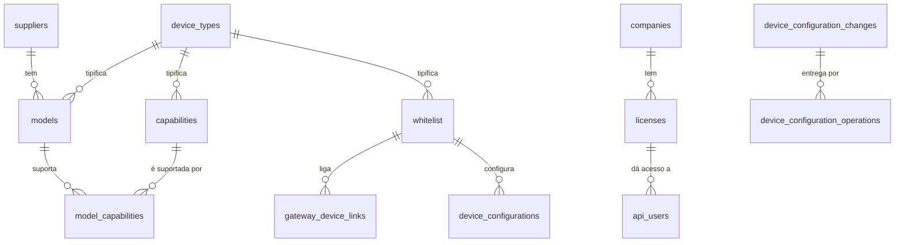

# 14 — Persistência

## Âmbito

A persistência assenta em duas bases de dados com funções distintas:

- **MySQL** armazena o estado durável: inventário de dispositivos, atribuição a
  clientes, capacidades suportadas e configuração.
- **Redis** armazena o estado corrente: presença, mensagens recentes, comandos
  pendentes e sessões abertas.

**Não existe tabela de telemetria.** A plataforma não constitui um arquivo
histórico — ver a
secção 3.

## 1. MySQL — as 20 tabelas



### Catálogo — o que existe no mundo

| Tabela | Guarda |
|---|---|
| `device_types` | Os tipos de dispositivo. Conteúdo vindo do `config/device-types.json` |
| `suppliers` | Os fornecedores. Nome único |
| `models` | Modelo interno, nome comercial, tipo de dispositivo, imagem |
| `model_capabilities` | Que capacidades cada modelo tem, com a possibilidade de sobrepor. A chave é a do `CapabilityCatalog`, que só existe no código; o `DatabaseSchemaGuard` recusa arrancar com uma chave que o catálogo não declare |

**O tipo de dispositivo tem uma tabela e três chaves estrangeiras.** Era um
`ENUM` repetido em `whitelist`, `models` e `model_capabilities`, e acrescentar um tipo
eram três `ALTER TABLE` que tinham de concordar — a discordância não produzia
erro, produzia um dispositivo registado e sem capacidade alguma. O conteúdo vem
do `config/device-types.json`, que o frontend também lê. O semeador só o aplica
numa base vazia — corre apenas quando a `device_types` está a zero —, por
isso acrescentar um tipo ao ficheiro num hub em serviço não chega à tabela sem
uma migração dedicada.

**A `model_capabilities` refere a capacidade pelo par natural**, e não pelo
`capabilities.id`. O identificador de substituição não era falado pelo código:
todas as leituras juntavam a `capabilities` apenas para o traduzir de volta à
chave. Com `ON UPDATE CASCADE`, renomear uma capacidade leva as ligações consigo.
O `capabilities.id` permanece como identificador exposto pela API.

**O `is_telemetry` deixou de ser coluna.** Coincidia com `section = 'telemetry'`
nas 167 linhas do catálogo, e é assim que a consulta o calcula; o campo
`isTelemetry` da API mantém-se.

### Registo — o que temos e de quem é

| Tabela | Guarda |
|---|---|
| `whitelist` | **O registo de dispositivos.** IMEI como chave, fornecedor, modelo, tipo, e o par empresa+licença |
| `gateway_device_links` | Que dispositivos BLE cada gateway pode retransmitir |
| `companies` · `licenses` | Os clientes. Uma licença é única dentro da sua empresa |
| `api_users` | Contas da API, com papel e âmbito |

### Configuração — o que pedimos e o que foi feito

| Tabela | Guarda |
|---|---|
| `device_configurations` | Estado atual por dispositivo e capacidade: desejado, reportado, revisões |
| `device_configuration_changes` | Uma linha por pedido de alteração, com o seu estado |
| `device_configuration_operations` | Que comandos foram construídos, com tentativas e erro |

Ver o [capítulo da configuração](10-configuracao-de-dispositivos.md).

**As operações não guardam os bytes do comando.** A entrega faz-se pela fila
`hub:downlink` do Redis, com TTL, e é lá que residem os bytes que saem no fio. A
tabela é um registo do que foi pedido e de como correu, e é lida apenas por
`change_id` — não existe despachante a consultá-la por estado.

**O histórico guarda a marca do áudio e não o áudio.** O aviso de medicação da 4P
Touch transporta a gravação em base64, e um ficheiro de 42 s ocupa 978 KB. Uma
cópia por revisão representava 69% da base de produção. As linhas de
`device_configuration_changes` conservam `voiceDataAvailable` e `voiceDataBytes`,
que é o vocabulário que a API já usava para o mesmo efeito.

A gravação permanece em `device_configurations`, porque essa tabela é a base de
fusão de uma alteração parcial: sem ela, uma alteração que mude apenas a hora do
aviso apagaria a voz do relógio. É também a cópia mais reduzida — uma linha por
dispositivo e capacidade, substituída e não acumulada.

### Resto

| Tabela | Guarda |
|---|---|
| `dashboard_notifications` | Recusas e avisos, com contagem de ocorrências e marca de lido |
| `denylist` | As identidades cujas mensagens as ingestões MQTT deitam fora sem as olhar, por protocolo |
| `private_radio_map_access_points` | O mapa de rádio. **Só resumos HMAC**, nunca endereços |
| `schema_migrations` | Que versões já foram aplicadas |

### Radar — o que o fornecedor sabe da divisão

| Tabela | Guarda |
|---|---|
| `radar_api_credentials` | As credenciais da cloud do fabricante, **uma linha por licença**, mais o par de tokens que ela devolve |
| `radar_layouts` | A planta da divisão de cada radar, em decímetros, como o fornecedor a serve |
| `radar_layout_areas` | As áreas dentro dessa planta: chave, tipo, nome e os quatro cantos |

**As credenciais do radar são reversíveis, e não há maneira de não o serem:**
servem para fazer login no fornecedor, que espera a palavra-passe. A defesa não
é a cifra, é a saída — não saem pela API, e a dashboard recebe apenas se estão
ou não preenchidas. A [`RadarLayoutSync`](04-ingestao-mqtt-radar.md#implementação) é quem as
usa, e os tokens ficam na base e não em ficheiro porque são duas instâncias do
hub na mesma máquina.

### Ausências deliberadas de chave estrangeira

**A `whitelist` não referencia `models`.** O fornecedor e o modelo são
armazenados como texto e associados ao catálogo por correspondência de nome. A
ausência de restrição permite registar um dispositivo de um modelo ainda não
catalogado.

**A tabela `device_configurations` não referencia a `whitelist`.** A remoção de
um dispositivo elimina as respetivas configurações numa transação explícita. Uma
chave estrangeira converteria uma mensagem em trânsito, no caminho crítico do
MQTT, numa exceção.

## 2. Esquema e migrações

O esquema **nunca** é alterado por uma ligação normal. `php bin/migrate.php` é um
passo explícito de instalação, e o hub **recusa arrancar** se a base estiver
atrasada.


O catálogo de referência — fornecedores, modelos, capacidades — é semeado **só
numa base sem capacidades**. Reiniciar o hub não recria o que foi apagado nem
desfaz escolhas de um administrador.

> **Uma migração corre antes do semeador, e isso tem uma armadilha.** A guarda do
> semeador é "a tabela `capabilities` está vazia?". Uma migração que escreva nessa
> tabela numa base de raiz faz a guarda saltar, e a instalação nasce sem
> fornecedores, sem modelos e sem empresas. Por isso a migração do catálogo
> começa por desistir quando a tabela está vazia: numa base nova não há nada a
> trazer a dia, e a linha de base trata do assunto.

Uma migração que já correu em toda a frota é **dobrada na linha de base** do
`database/schema.sql` e sai do plano: uma base nova nasce com o resultado já
feito, e o plano fica só com o que ainda falta aplicar algures. Foi o que
aconteceu às onze de setembro de 2026, da auditoria ao esquema, e é por isso que
não estão em `src/Infrastructure/Persistence/Migration/` — o que elas fizeram
está descrito abaixo porque explica o esquema de hoje, não porque ainda corra.

O plano em vigor é o `DatabaseMigrationPlan`, uma classe por versão, com o que
ainda não foi dobrado na linha de base.

O `DatabaseSchemaGuard` só exige o que estiver no plano, e por isso as linhas que
sobram na `schema_migrations` não incomodam.

### O que a linha de base já traz feito

As treze de outubro de 2026 foram dobradas no `schema.sql` e no
`ReferenceCatalogSeeder`:

| Migração | O que faz |
|---|---|
| `whitelist_key_cascades_on_rename` | As chaves que apontam para o `whitelist.imei` acompanham a renomeação |
| `capability_sections_include_reminders` | A `capabilities.section` ganha o valor `reminders` |
| `unconfirmed_heart_rate_alarm_is_unlinked` | Tira dos relógios o `heart_rate_abnormal`, que nenhum protocolo anuncia |
| `2026_10_15_configuration_operation_target` | A operação guarda a quem se refere, o `target` |
| As sete de catálogo e imagens | A pulseira PST CF103W, as balanças Unique Scales e o gateway BLE, os quatro JoyTech, e o radar Qinglanst como `HC2` |

As oito de 4 de setembro fecharam a auditoria ao esquema:

| Migração | O que faz |
|---|---|
| `drop_unread_lifecycle_columns` | Larga o `imei` e o `config_key` das operações, que copiavam a alteração, e o `confirmed_revision`, escrito e nunca lido |
| `drop_capability_telemetry_flag` | Larga o `is_telemetry`, que repetia a secção |
| `drop_api_user_license_number` | Larga o `api_users.license_id`, que repetia o número da licença apontada |
| `configuration_timestamps_to_datetime` | Converte os onze instantes de texto para `DATETIME`, e a cadeia vazia para `NULL` |
| `device_types_table` | Dá aos tipos de dispositivo uma tabela e três chaves estrangeiras |
| `shrink_legacy_varchar_191` | Encurta as vinte e quatro colunas em `VARCHAR(191)` |
| `model_capabilities_by_natural_key` | Aponta as ligações ao par `(device_type, capability_key)` |
| `device_type_ascii_collation` | Converge as cinco colunas `device_type` para `ascii_bin`, reconstruindo as chaves estrangeiras que nelas assentam |

Cada uma verificava antes de converter e desistia em vez de perder informação:
uma coluna que discordasse da origem, um valor que não fosse ISO-8601, um texto
que não coubesse na largura nova.

E as três de 3 de setembro:

A `2026_09_03_drop_configuration_supplier_and_model` largou o `supplier` e o
`model` da `device_configurations`. Eram cópia do que a `whitelist` diz sobre o
IMEI, escritas em três caminhos e lidas em nenhum, e a cópia divergiu: as linhas
órfãs do IMEI `000060060298220` declaravam dois modelos para o mesmo aparelho.

A `2026_09_03_drop_supplier_device_types` largou a tabela que respondia a «que
fornecedores fazem cada tipo de dispositivo». A pergunta responde-se com um
`SELECT DISTINCT` sobre a `models`, que é a origem — ver
`ModelRepository::supplierDeviceTypes()`. A tabela era escrita num sítio só e
apenas a inserir, pelo que apagar o último modelo de um tipo, ou mudar-lhe o
tipo, deixava lá o par a afirmar o contrário.

A `2026_09_03_shrink_configuration_lifecycle` largou as três colunas de
`device_configuration_operations` que eram escritas e nunca lidas —
`command_bytes`, `expected_reply_types` e `retry_delay_seconds` —, largou os
cinco índices que nenhuma consulta podia usar, repôs dois deles pela ordem em
que são procurados, e converteu os `desired_payload` e `effective_payload` que
já existiam para a marca do áudio.

A conversão dos dados recorre ao `VoiceDataMarker`, que é o mesmo código que
escreve as linhas novas. As linhas antigas e as novas não podem, por isso,
divergir de forma.

O inventário de exemplo — 26 dispositivos, licenças, imagens — é `bin/seed-inventory.php`
e está **fora** do plano de migrações de propósito: senão cada teste de integração
começava com 26 dispositivos lá dentro.

## 3. Redis — os oito espaços de chaves

| Prefixo | Guarda | Expira? |
|---|---|---|
| `hub:dashboard` | Presença, metadados em execução, histórico, comandos, avistamentos, alarmes que duram | não — mas limitado; os alarmes que duram, sim |
| `hub:api-tokens` | Os dois tipos de token | sim, é o TTL que os valida |
| `hub:downlink` | A fila de comandos por entregar | sim, 300 s |
| `hub:moko` | De-duplicação, refrescamento e transições de estado BLE | parcialmente |
| `hub:location:circuit` | O estado do disjuntor | sim |
| `hub:location:resolution` | Cache de resoluções de localização | sim, 24 h ou 60 s |
| `hub:login-throttle` | Os contadores que travam as tentativas de autenticação, por endereço, por utilizador e global | sim, é a janela de cada teto |
| `hub:firmware-upgrade` | A actualização de firmware em curso de cada aparelho | sim, 24 h |

### O histórico é limitado, não é um arquivo

Cada dispositivo tem cinco listas — `raw`, `telemetry`, `events`, `connections`,
`commands` — e cada uma guarda as últimas **100** entradas
(`DASHBOARD_HISTORY_LIMIT`). O corte é feito no mesmo pipeline da escrita.

As `connections` são os `device.connected` e `device.disconnected`, que o `append`
desvia de `events` e guarda só quando mudam o estado. Têm lista própria porque os
alarmes de um radar enchem os cem eventos em poucas horas. Um aparelho já ligado
que ainda não tenha nenhuma começa-a com um `device.connected` na primeira vez que
é visto, só no histórico.

A retenção é dimensionada para a apresentação do passado recente na dashboard.
**A conservação de série temporal cabe às aplicações que subscrevem o MQTT.**

Dois tipos de mensagem são excluídos do histórico, pelo volume que representam:
os sinais de vida dos relógios e os relatórios de varrimento dos gateways.

### O histórico é também o transporte do stream

A escrita no histórico é o que acorda o stream em directo. O `append` de uma
entrada de `telemetry`, de `events` ou de `connections` chama o `DeviceUpdateNotifier`, a que o
`GET /api/devices/{imei}/stream` está subscrito, e é esse aviso que faz a
dashboard voltar a desenhar — o mapa da planta de um radar incluído.

**Travar escritas no histórico é travar a interface.** Quem lhe queira reduzir o
volume tem de contar com isso: uma amostragem que pareça só poupar Redis atrasa,
pela mesma medida, tudo o que o ecrã mostra em directo. As únicas escritas que se
podem amostrar sem custo visível são as que não passam pelo notificador — o
`raw`, e a marca de "vi este aparelho".

### Alarmes que duram

Os aparelhos que repetem uma condição enquanto ela dura — a queda do radar, a
avaria do dispensador, a bandeira de bateria fraca — só a
[anunciam quando começa](08-contrato-mqtt.md#o-que-dura-sai-uma-vez). O que já
saiu fica num hash por aparelho, `hub:dashboard:device:{imei}:active-alarms`, um
campo por detecção ou condição, e por isso um reinício do hub não o volta a
anunciar.

Cada campo leva o seu prazo no próprio valor, e a repetição renova-o. Passado o
prazo, o aparelho calado volta a anunciar o que trouxer:

| Quem | Campo | Prazo |
|---|---|---|
| Radar | o tipo de trama (`position`, `hbstatics`) | 150 s, o silêncio com que se dá por desligado |
| Dispensador | a condição (`device_fault:…`, `storage_environment`) | 150 s, idem |
| Dispensador | `help_call`, que o heartbeat não repete | 10 min |
| Bateria fraca | `low_battery` | 24 h: só apaga com uma carga, que chega como leitura |

O hash inteiro expira ao fim de 24 h sem escrita.

## 4. Duas instâncias no mesmo Redis

A raiz `hub:` **já é partilhada** com o reencaminhador, que é outra aplicação e
lá tem as suas `hub:forward:*` e `hub:crm:target:*`.

A variável `REDIS_PREFIX` permite executar uma segunda instância contra o mesmo
Redis. O valor vazio corresponde a produção, mantendo as chaves nas suas
posições originais; a instância de desenvolvimento usa `dev:`.

**O prefixo é aplicado ao cliente e não a cada componente.** Existem oito
espaços de chaves, e a aplicação por componente faria com que um nono espaço
adicionado posteriormente ficasse sem prefixo, sem erro visível. Um teste
verifica os oito.

Uma segunda instância a escrever nas mesmas chaves não produziria erro:
sobreporia o estado dos dispositivos da primeira e as sessões das duas
dashboards seriam partilhadas.

## 5. O que se perde ao reiniciar

| | Sobrevive? |
|---|---|
| MySQL | tudo |
| `hub:dashboard` | sim — não tem TTL, menos os alarmes que duram, cada um no seu prazo |
| `hub:moko:last` e `:condition` | sim, por ausência deliberada de TTL |
| `hub:api-tokens`, `hub:downlink`, `hub:location:*`, `hub:moko:dedupe` | conforme o TTL |
| Ligações TCP abertas, gateways online, janelas de proximidade | **não**, por residirem em memória do processo |

O estado do disjuntor reside no Redis por decisão: um processo reiniciado
durante uma indisponibilidade externa não retoma de imediato as chamadas ao
serviço.

## 6. Verificação do isolamento

A contagem das chaves de cada instância, antes e depois de uma alteração,
identifica eventuais escritas no espaço da outra:

```bash
redis-cli --scan --pattern 'hub:*'     | grep -vc '^dev:'
redis-cli --scan --pattern 'dev:hub:*' | wc -l
```

As chaves `hub:forward:*` e `hub:crm:target:*` pertencem ao reencaminhador e
integram a primeira contagem sem pertencerem ao hub.

## 7. Ligado e desligado

O estado de ligação vive no `hub:dashboard` — a bandeira `online` do aparelho e o
conjunto ordenado pela última vez que falou — e é o mesmo que sai no `status` do
MQTT e no `device.presence` da API.

**A regra.** Um aparelho dá-se por desligado depois de **dois sinais de vida
falhados**: calado durante `2 × intervalo + 30 s`. O intervalo é o que o hub tem
confirmado na configuração do aparelho, quando o tem; senão, o que o fornecedor
documenta; e, quando a documentação não o diz, o que se mediu em produção. Os
valores estão no [`Liveness`](../src/Domain/Liveness.php), um por protocolo, cada
um com a sua fonte.

**Um sítio só.** A manutenção do hub varre o conjunto de dez em dez segundos e
anuncia `status offline` retido e `device.disconnected` de quem passou o prazo do
seu protocolo. Uma ligação TCP aberta decide-a o servidor, pelo mesmo prazo: fecha
o socket, que é o que deixa de escrever comandos para um aparelho que já não está
lá.

| Protocolo | Categoria | Sinal de vida | Intervalo | Fonte | Prazo | Estados |
|---|---|---|---|---|---|---|
| `wonlex-json` | contínuo | `heartbeat` | 300 s | a especificação não o fixa; 303 s observado em produção, 22/10/2026 | 630 s | `online` / `offline` |
| `four-p-touch` | contínuo | `LK` | 300 s | 5 a 8 min pela especificação; 300 s observado em produção, 22/10/2026 | 630 s | `online` / `offline` |
| `vivistar-iw` | contínuo | `AP03` | 480 s; com `working_mode` confirmado em `power_saving`, 3600 s, e em `custom`, o `intervalSeconds` se for maior | o AP03 só se regula por SMS (`#hb#`); 480 s observado em produção, 22/10/2026; os modos no BP33 | 990 s | `online` / `offline` |
| `zayata-m228` | contínuo | heartbeat `0x02` | 60 s | o `0x8004` que o aparelho declara no registo ([19a](19a-dispensador-parametros.md)) | 150 s | `online` / `offline` |
| `moko-mkgw3` (MKGW3 e MKGW-mini) | contínuo | estado de rede `3004` | 30 s | MKGW3 MQTT V2.3 §3.3.3, omissão | 90 s | `online` / `offline` |
| `moko-mkgw4` | contínuo | estado `0x3004` | 600 s | regula-se no `0x100C`, que o hub não guarda; 600 s é o mais lento observado em produção, 22/10/2026 | 1230 s | `online` / `offline` |
| `havicare-ble-gateway` | contínuo | `heartbeat` do `havicare-gateway` | 60 s | `HEARTBEAT_MS` do havicare-ble-gateway | 150 s | `online` / `offline` |
| `veepoo-ble` | contínuo | o `session` que o gateway repete enquanto a ligação dura | 30 s | `HEARTBEAT_SECONDS` do havicare-ble-gateway | 90 s | `online` / `offline` |
| `monit-mecs-pro-ble`, `moko-w6`, `moko-w6b` | contínuo | anúncio BLE retransmitido | 600 s | sem intervalo documentado: chegam ao ritmo do MKGW4, que sobe o que viu de 600 em 600 s (Config APP V2.1 §4.3.1); 31–44 s atrás de um MKGW3 | 1230 s | `online` / `offline` |
| `qinglanst-radar` | contínuo | `position` | 60 s | 30 s sem gente pela especificação (Cloud2cloud V2.2.3 §3.3.1); p99 de 62 s observado em produção, 22/10/2026 | 150 s | `online` / `offline` |
| `voerka-ncs` | contínuo | `status/online` com `code` 1001 | 1200 s | a especificação só documenta o de ligação; 13 a 20 min observado em produção, 22/10/2026. O testamento no broker diz o `offline` sem esperar (Voerka §4.2) | 2430 s | `online` / `offline` |
| `tuya-cloud` | reportado pela cloud | o `deviceOnline` e as leituras; o `deviceOffline` só o adormece | 28800 s | o botão acorda de 8 em 8 h, observado em produção, 22/10/2026 ([21](21-pulseira-sos-wifi.md)) | 57630 s | `online` / `idle` a dormir / `offline` |
| `lefu-torre`, `joytech-bp`, `joytech-bp-ecg`, `joytech-et`, `joytech-spo2` | a pedido | a sessão GATT e as tramas dela | — | ligam-se para medir e desligam-se | 120 s sem tramas acabam a sessão | `measuring` / `idle` |

**A pedido.** A balança, o tensiómetro, o termómetro e o oxímetro passam a maior
parte do tempo desligados, e isso é o normal deles. Não têm `online` nem
`offline`: durante a sessão GATT estão `measuring`, e fora dela `idle`, com a
última leitura no `lastSeenAt`. A sessão acaba com o `connected: false` ou com
120 s sem tramas — um gateway que caiu a meio também a acaba. Na dashboard não
levam «Desligado»: levam «A medir» durante a sessão e «Última leitura há …» fora
dela.

**A dormir.** O botão SOS da Tuya acorda de oito em oito horas e volta a dormir
minutos depois, e a cloud diz as duas coisas. A dormir está `idle`: carregar no
botão acorda-o e o SOS chega. Adormecer não publica `device.disconnected` nem
adia o prazo, que conta do último despertar; desligado é não ter acordado duas
vezes.

**A lista.** O filtro «Ligados» da API e da dashboard (`?online=online`) traz os
`online` e os `measuring`, e o «Desligados» (`?online=offline`) só os `offline`;
os `idle` ficam nos dois de fora, e aparecem só sem filtro. O «N ligados» do
cabeçalho conta os mesmos que o «Ligados».

**O que não tem sinal.** Os botões e os pagers do NCS não são aparelhos do hub:
aparecem só no `data.pagerId` das chamadas, e o que se sabe deles é a última vez
que se carregou.

## Implementação

| Ficheiro | Responsabilidade |
|---|---|
| `database/schema.sql` | A linha de base — as 20 tabelas |
| `database/seed.sql` · `bin/seed-inventory.php` | O inventário de exemplo |
| `src/Infrastructure/Persistence/DatabaseMigrator.php` | Esquema, migrações, catálogo |
| `src/Domain/VoiceDataMarker.php` | A marca do áudio, no histórico e na resposta |
| `src/Infrastructure/Persistence/DatabaseSchemaGuard.php` | Recusa arrancar atrasado |
| `src/Infrastructure/Persistence/ReferenceCatalogSeeder.php` | Fornecedores, modelos e capacidades |
| `src/Api/Repository/` | Um repositório por assunto |
| `src/Dashboard/DeviceRuntimeStore.php` · `DeviceEventStore.php` · `DeviceCommandStore.php` | Os três espaços de `hub:dashboard` |
| `src/Runtime/HubServices.php` | Onde o prefixo do Redis é aplicado |
| `src/Domain/Liveness.php` | O intervalo e o prazo de cada protocolo, e os estados de presença |
| `src/Runtime/MaintenanceScheduler.php` | A varredura que dá por desligado quem passou o prazo |
| `tests/Unit/Runtime/RedisPrefixTest.php` | Tranca os oito espaços de chaves |
