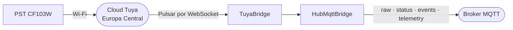

# 21 — Pulseira SOS Wi-Fi: ingestão pela cloud da Tuya

## Âmbito

A pulseira **PST CF103W** é um botão de pânico Wi-Fi com um módulo da Tuya. O
firmware é da Tuya e só fala com a cloud dela: o fabricante não o altera, e não
há maneira de apontar o aparelho para o hub. O hub recebe-a **da cloud da
Tuya**, pelo Message Service de um projeto na Tuya IoT Platform.

O aparelho dorme. Acorda quando se carrega no botão e **de oito em oito horas**,
manda a bateria, e volta a dormir uns minutos depois. Na Tuya é da categoria
`sos` e tem só dois pontos de dados:

| Código Tuya | DP | Tipo | No hub |
|---|---|---|---|
| `sos_state` | 23 | booleano | `help_call` no canal `events`, quando passa a `true` |
| `battery_percentage` | 3 | inteiro 0–100 | `battery` no canal `telemetry`, `data.percent` |

Não há nada que se configure nem comandos a enviar.



## 1. A ligação

O hub abre um WebSocket para o Pulsar da Tuya e fica a ouvir:

```text
wss://mqe.tuyaeu.com:8285/ws/v2/consumer/persistent/{accessId}/out/event/{subscrição}?ackTimeoutMillis=3000&subscriptionType=Failover
```

- **Autenticação:** cabeçalhos `username` (o Access ID) e `password`, que é
  `md5(accessId . md5(accessSecret))` do carácter 8 ao 24.
- **Confirmação:** cada mensagem confirma-se com `{"messageId": …}` depois de
  tratada. Uma trama que não se lê confirma-se e larga-se, porque voltaria para
  sempre. Uma falha do hub (Redis ou base de dados em baixo) não confirma, e o
  Pulsar volta a entregar a mensagem três segundos depois; à quinta entrega
  falhada, larga-se com erro no log.
- **Reentregas:** o `messageId` de cada mensagem já publicada fica no Redis
  (`hub:tuya:handled:{messageId}`) durante **três horas**, uma a mais do que a
  retenção da Tuya. Uma reentrega dessa mensagem confirma-se sem publicar nada,
  e o `help_call` não se repete. Marca-se só depois de o alarme sair: uma falha
  antes disso volta a ser tratada por inteiro. Com o Redis em baixo não se sabe
  o que já saiu, e publica-se — um `help_call` repetido em vez de um perdido.
- **Ligação perdida:** volta a ligar sozinha, de 1 a 60 segundos de espera. Um
  `ping` a cada 30 segundos mantém-na aberta, e sem nada do servidor durante 90
  segundos fecha-se e volta a abrir.
- **Retenção:** a Tuya guarda o que não foi confirmado durante **duas horas**.
  Um hub em baixo mais do que isso perde os alarmes desse intervalo.

Cada trama traz a mensagem de negócio cifrada em AES-128-GCM (a propriedade
`em` é `aes_gcm`) com os caracteres 8 a 24 do Access Secret: os 12 primeiros
bytes são o nonce e os 16 últimos a etiqueta. O ECB dos projetos anteriores a
2023 não se lê.

O código está em `src/Ingress/Tuya/`: `PulsarFrame` abre a trama, o
`MessageNormalizer` traduz, e a `TuyaBridge` liga, publica e regista.

## 2. As mensagens

| `bizCode` | O que o hub faz |
|---|---|
| `devicePropertyMessage` | Traduz cada propriedade como na tabela do âmbito. O `occurredAt` é a hora a que o aparelho a reportou. O `sos_state` a `false` é o botão a voltar sozinho ao repouso, e não sai |
| `deviceOnline` | O botão acordou: fica `online` |
| `deviceOffline` | O botão adormeceu: fica `idle`, sem `device.disconnected` |
| os outros | Ignoram-se: são da cloud, e não do aparelho |

O `source.protocol` é `tuya-cloud` e o `source.nativeType` é o código Tuya do
ponto de dados.

## 3. Ligado e desligado

A pulseira acorda de oito em oito horas para dar a bateria e volta a dormir
minutos depois, e a cloud da Tuya diz as duas coisas. O hub segue-a:

- **`online`** com o `deviceOnline` ou com qualquer leitura. Acordar de um sono
  publica só o `status`; o `device.connected` fica para quem vinha de desligado.
- **`idle`** com o `deviceOffline`: está a dormir, e carregar no botão acorda-o e
  o SOS chega. Sai o `status` retido e nenhum `device.disconnected` — um
  cuidador que visse a pulseira desligada três vezes por dia julgá-la-ia avariada.
- **`offline`**, com `device.disconnected`, só ao fim de dois despertares
  falhados: 2 × 28800 + 30 s sem `deviceOnline` nem leitura. O `deviceOffline`
  não conta como despertar.

## 4. Identidade e registo

O identificador do aparelho é o `devId` da Tuya (22 caracteres, por exemplo
`bf7cbe84a6199e98168qvb`). Regista-se na whitelist com esse valor, fornecedor
`PST` e modelo `CF103W`, tipo `bracelet`. Um `devId` desconhecido aparece nos
aparelhos por registar, como os dos outros protocolos.

Para chegar ao projeto Tuya, a pulseira emparelha-se na app Tuya Smart com uma
conta ligada ao projeto (*Devices → Link App Account*).

## 5. Configuração

| Variável | |
|---|---|
| `TUYA_ENABLED` | Liga a ingestão; desligada por omissão |
| `TUYA_ACCESS_ID`, `TUYA_ACCESS_SECRET` | As chaves do projeto Tuya (*Cloud → Project → Overview*) |
| `TUYA_PULSAR_URL` | `wss://mqe.tuyaeu.com:8285/`, o da Europa Central |
| `TUYA_SUBSCRIPTION` | A subscrição Pulsar desta instância |

**Cada instância usa a sua subscrição.** O tópico de produção tem onze partições,
e dois consumidores na mesma subscrição repartem-nas: cada instância veria só
parte dos aparelhos. A produção usa a `{accessId}-sub`, que a Tuya cria; o dev
usa outra, criada na consola (*Message Service → Subscription Management*), e
cada subscrição recebe uma cópia de tudo.

## 6. Licença e limites

O projeto está no plano **Trial** do IoT Core: 50 aparelhos, 68 000 mensagens por
mês, um mês de validade renovável à mão na consola, e **uso comercial
proibido**. Com clientes é preciso um plano pago ou o *Device Data Sharing* do
Data Act; nenhum dos dois tem preço público.

Do próprio aparelho: dois toques com menos de um ou dois segundos entre eles não
dão alarme; toques com dez segundos de intervalo dão todos.
